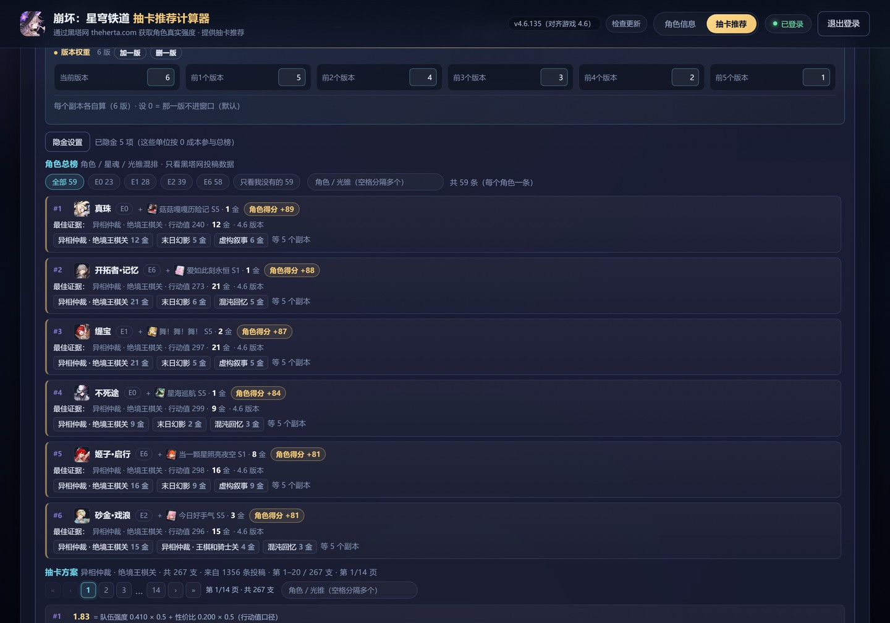
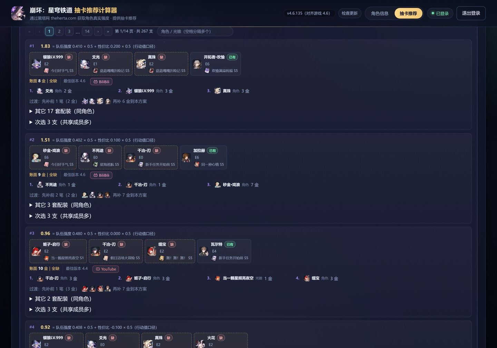
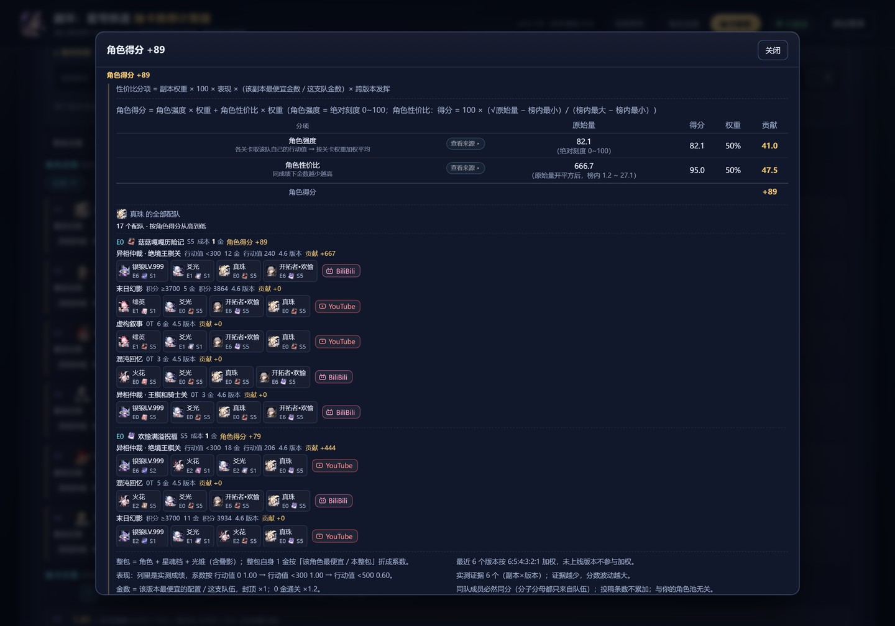
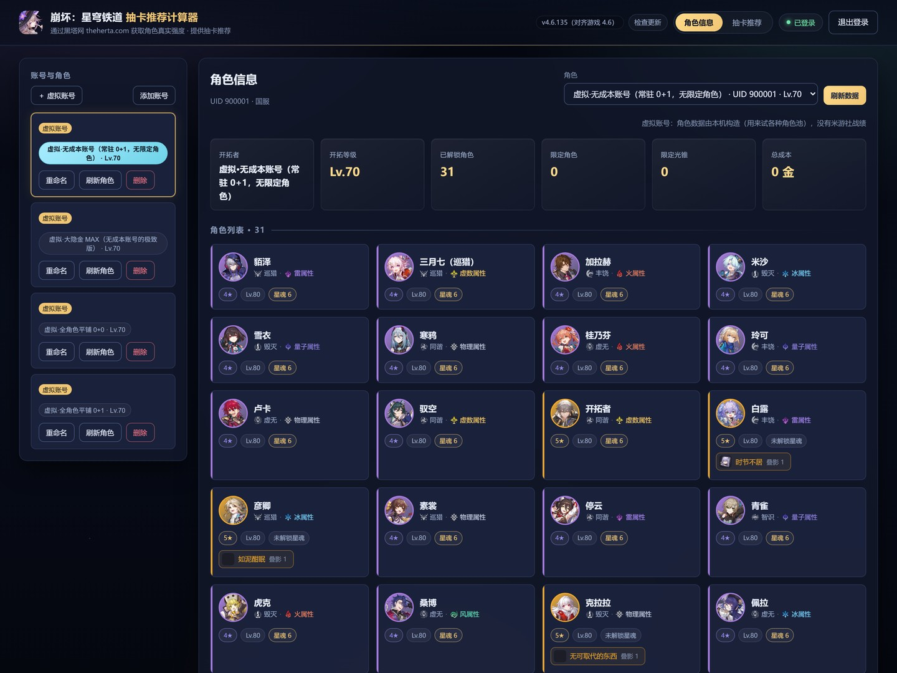

# 崩坏：星穹铁道 抽卡推荐计算器

用[黑塔网](https://www.theherta.com)的公开投稿数据 + 本机缓存的米游社角色快照，回答一个具体问题：
**下一个金花在谁身上最划算**。

零第三方依赖、纯本地运行；打开页面、搜索、翻页都不联网，只有你点「同步」才会抓数据。

> **下载**：最新便携包见 [Releases](https://github.com/mxf133/hsr-character-viewer/releases) —— 解压后双击 `start.bat`，不用 `npm install`。



## 它回答什么

- 已有的角色里，**下一个金花在谁身上**最划算？补几魂、几叠影？
- 同样一份成绩，**哪套阵容更省金**？（同为绝境 0T，9 金那支优于 16 金那支）
- 这个分数**到底怎么算出来的**？（逐关卡：权重 × 表现 × 金数 × 版本，可逐行验算）

## 界面

**抽卡推荐 · 补金方案** —— 窗口内**所有档位**的投稿都列出来（绝境实测 1985 条投稿 / 345 支 / 18 页：最好一档 267 支在前，其余档位按档分组跟在后面并全部可搜），搜索覆盖整个候选池，而不只是当前页。



**得分来源** —— 每个分数都能点开：各分项怎么合成总分，每一项的原始量、归一区间、权重与贡献。



**角色信息** —— 扫码登录后读你账号的真实面板（等级 / 星魂 / 光锥 / 遗器 / 行迹）；不想登录就切虚拟账号，
从 9 种角色池预设里挑一个试算，不动你的账号。



## 快速开始（Windows）

1. 装 [Node.js](https://nodejs.org) ≥ 18.17（本项目零依赖，不用 `npm install`）。
2. 双击 `start.bat`（等价于 `npm start`），浏览器自动打开 <http://127.0.0.1:8360>。
3. 右上角**扫码登录**米游社（或手动粘贴 cookie）→ 点「同步黑塔网数据」。

> 登录凭证与角色快照只写本机 `data/`，该目录已在 `.gitignore` 中，**不会**进版本库。
> 不登录也能看角色总榜；登录后才会标出「已有」，并据此算补金方案。

## 评分口径（v4.6.135）

**角色得分** = 角色强度 × 权重 + 角色性价比 × 权重（默认各 50%，可自己调）

- **角色强度**：按副本算行动值表现，再按**版本权重**加权平均。打出 0 行动值（绝境）/ 0T（轮次制）时，
  最省金的那支满分，其余每多 1 金扣 0.1 分 —— 所以满分要「每个版本都顶格且最省金」。
- **角色性价比**：同一份成绩下金数越少越高，最近 6 个版本按 6:5:4:3:2:1 加权。

**补金推荐分** = (强度权重 × 队伍强度 + 性价比权重 × 队伍性价比) × 版本权重

- **队伍性价比** = `1 − 补金数 ÷ 10`：补满 10 金归零，再多转负；补得越少越接近 100。

口径的由来与每一轮的实测数字见 [`docs/评分模型设计.md`](docs/评分模型设计.md)，
可逐条验收的功能清单见 [`docs/功能要求.md`](docs/功能要求.md)。

## 数据来源

- **强度数据**：黑塔网 theherta.com 的公开投稿（缓存于 `theherta/archive.json`）。
- **角色面板**：米游社官方接口，扫码登录后抓取一次。
- 截图里的账号与角色数据均由本机构造的**虚拟账号**生成，不含任何真实玩家数据。

## 目录结构

```
bin/       启动与版本脚本
src/       服务端：登录与签名、缓存策略、评分计算
public/    前端：原生 ES 模块 + 手写 CSS，无构建步骤
tools/     数据抓取、测试套件、探针
theherta/  黑塔网数据集（archive.json + 中英名称映射）
docs/      设计文档与截图
```

## 测试

```bash
node tools/run-tests.mjs          # 全部套件
node tools/run-tests.mjs --list   # 列出套件名
```

## 说明

非官方工具，与米哈游 / HoYoverse、黑塔网均无关联；数据版权归各自作者，仅供学习与娱乐参考。
MIT License，见 [LICENSE](LICENSE)。
