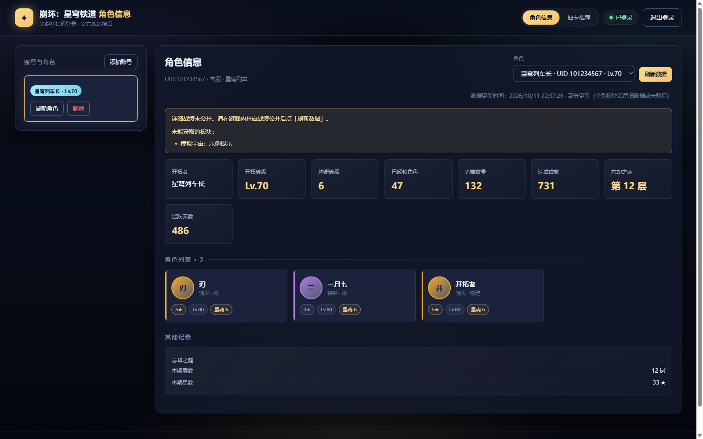
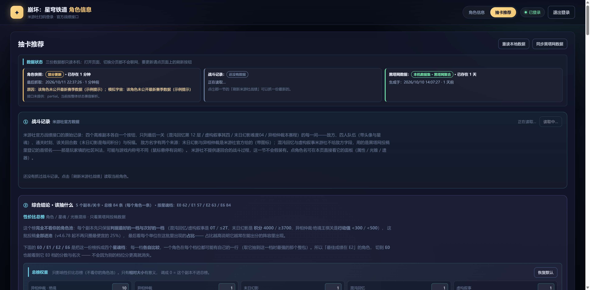
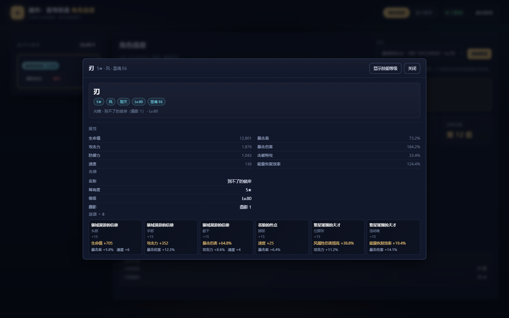

# 崩坏：星穹铁道 · 角色信息查询 + 抽卡推荐

> **开发说明**：本程序完全使用 **vibe coding** 完成。欢迎通过 issue 或 pull request
> 报告问题、补充测试和改进实现。

一个本地运行的《崩坏：星穹铁道》角色信息查询工具：**米游社扫码登录**，然后读取
**米游社官方战绩接口**展示角色信息（等级、星魂、属性、光锥、遗器）；另有一个
**抽卡推荐**分页，基于 [theherta.com](https://theherta.com/archive) 的高难副本
投稿统计给出抽取建议（离线数据，不联网也能用）。

界面是网页 GUI，后端是一个**零第三方依赖**的 Node.js 服务（只用 Node 标准库）。

## 功能预览

下面的截图使用本地合成数据，仅用于展示界面，不包含真实账号信息。

<table>
  <tr>
    <td></td>
    <td></td>
  </tr>
  <tr>
    <td align="center">角色信息总览</td>
    <td align="center">抽卡推荐与数据状态</td>
  </tr>
  <tr>
    <td colspan="2"></td>
  </tr>
  <tr>
    <td colspan="2" align="center">角色详情面板：属性、光锥、遗器和星魂</td>
  </tr>
</table>

## 直接下载

Windows 用户可以直接下载 [最新便携包](https://github.com/mxf133/hsr-character-viewer/releases/latest)：

1. 解压压缩包。
2. 确认电脑已安装 **Node.js 18.17 或更新版本**。
3. 双击 `start.bat`，程序会启动本地服务并打开浏览器。

程序只在本机保存登录凭证和战绩缓存；公开发布包不包含任何账号文件、Cookie 或本机缓存。

> **当前版本见 [`src/version.js`](src/version.js)**（唯一来源：服务启动时打印、界面页脚
> 显示、`/api/config` 返回）。版本号跟着游戏走：**主版本 = 对齐的游戏版本，末位是
> 本工具在同一游戏环境里的修订号**（如 `v4.6.68` = 对齐游戏 4.6、第 68 次修订）。
>
> **逐版本的改动说明在 `src/version.js` 的 changelog 里**（讲「为什么改」），
> 「某一版动了哪些文件」在 [`docs/变更流水账.md`](docs/变更流水账.md)。
> 本文件不再维护版本清单（旧清单停在 v4.6.44，已删除以免与 changelog 冲突）。
>
> **读这份 README 的建议**：它约 1500 行，**按需查、不必全文读**。
> 「抽卡推荐分页」一节最长（约 800 行），是功能说明的集中地；
> 只想快速上手看「快速开始」与「工作原理」即可。
---

## 快速开始

需要 **Node.js ≥ 18.17**（使用了内置 `fetch`；开发与测试在 Node 24 上完成）。

### Windows 一键启动（推荐）

**双击 `start.bat`** 即可：

1. 启动本地服务
2. 服务就绪后自动打开浏览器
3. **关闭这个窗口（或按 Ctrl+C）就等于关闭应用** —— 不会有残留进程占着端口

启动时控制台会先印出**当前版本号**（窗口标题里也带一份），形如：

```
  Honkai: Star Rail - Character Info Viewer   v4.6.74
```

> 用户 2026-10-11 要求「启动脚本改成 `.bat`，并且显示当前版本号」。
> 版本号的**唯一来源仍是 `src/version.js`**（`HANDOFF.md` §4.4「一个数字只在一个地方定义」），
> 批处理里**不许**写死一份 —— 它经 `bin/version.mjs` 读出来：这个脚本只做「读出来、
> 打到 stdout」，输出必须是**一行、只有版本号**，因为 `start.bat` 用
> `for /f "delims=" %%V in ('node bin\version.mjs 2^>nul') do …` 抓它。
> 读不到时（node 在位但脚本被删）退化成 `vunknown`，**不会**让启动失败。

也可以在命令行运行：

```bat
start.bat
set DSH_HSR_PORT=9000 && start.bat     :: 换端口
set DSH_HSR_OPEN=0 && start.bat        :: 不自动开浏览器
start.bat 0.0.0.0                      :: 允许局域网访问（%1 可给端口或地址）
node bin\version.mjs                   :: 只打印当前版本号（一行）
```

脚本会先检查 Node.js、`bin\serve.mjs` 是否就位；如果端口上已有服务在跑，
它只打开界面、不会重复启动（这条路径同样会先显示版本号）。

打开浏览器的过程（`bin/open-when-ready.ps1`，由 `start.bat` 用 `start /b` 在同一
控制台里启动）：

1. 先打印一行 `Will open http://127.0.0.1:8360/ in the browser as soon as the
   server answers ...`，让你知道它在等；
2. 每 350ms 探测一次端口，**最长等 60 秒**（`DSH_HSR_OPEN_TIMEOUT` 可改）。
   探测是直接开 socket 发一个 `GET /`：
   - 不用 `Invoke-WebRequest`，因为它**不限制 TCP 连接阶段**的超时（探测死端口
     每次要约 21 秒），而且会走系统代理——代理坏掉时连 `127.0.0.1` 都打不开；
   - 也**不要求 `/api/config` 返回 200**：设了 `DSH_HSR_TOKEN` 时它会返回 401，
     但服务其实已经就绪。任何 HTTP 状态码都算「起来了」；
   - 会依次试配置的地址、`127.0.0.1`、`::1`，所以服务只监听 IPv6 也能等到。
3. 就绪后打印 `Server is ready, opening the browser: <地址>`，然后**按顺序**尝试：
   1. **按真实路径启动系统默认浏览器**：从 `UrlAssociations\http\UserChoice` 读出
      ProgId，再取其 `shell\open\command` 里的 exe 路径，直接
      `chrome.exe <地址>`。这条路**不经过外壳**，也就不会弹出
      「Windows 无法访问指定的设备、路径或文件」那种系统对话框；
   2. 上面失败就依次试已安装的浏览器（Chrome / Edge / Brave / Firefox / Opera /
      Vivaldi，按 `ProgramFiles` 等环境变量定位）；
   3. 都不行才退回 `cmd /c start "" "<地址>"`（也就是双击链接那条路）。
   每次启动后都**检查进程是否真的活着**：浏览器起不来时会在一两秒内退出，而
   `cmd /c start` 即使什么都没打开也照样报成功——不检查就会出现「提示已打开、
   实际什么都没发生」。三次都失败则打印 `[WARN]` 和手动地址。
4. 超时仍未就绪就打印 `[WARN] port ... did not answer within 60s` 并退出，
   而不是默默什么都不做——那种「窗口正常、浏览器没开」最难查。

想让它在别的浏览器里打开，设 `DSH_HSR_OPEN_CMD`，例如
`set "DSH_HSR_OPEN_CMD=C:\Program Files\Google\Chrome\Application\chrome.exe"`
（它会被最先尝试，后面的兜底仍然有效）。

> **关于「打开文件 - 安全警告 / 未知发布者」**：这是 Windows 对 `.bat`、`.ps1`
> 这类脚本的例行提示，和程序本身无关——脚本没有数字签名，谁双击都会看到。
> 点**运行**即可；不想要这个提示，右键文件 → 属性 → 勾选底部的
> **解除锁定（Unblock）**，或对本目录执行一次
> `Get-ChildItem -Recurse | Unblock-File`。

> 实现要点（都踩过坑，写在 `start.bat` 的注释里）：
> - 脚本**必须是纯 ASCII**：cmd.exe 按 OEM 代码页（简中是 GBK）解析 `.bat` / `.cmd`，
>   无 BOM 的 UTF-8 中文会被拆坏，导致脚本报一堆
>   `'xx' is not recognized as an internal or external command`。
>   脚本内部用 `chcp 65001` 切到 UTF-8，**服务输出的中文才不会乱码**。
> - 版本号是从 `bin/version.mjs` 现读的（见上面那个方框），所以**改版本号只需要改
>   `src/version.js`**，启动横幅与窗口标题自动跟着变。
> - `bin/open-when-ready.ps1` **同样必须纯 ASCII**：PowerShell 5.1 读无 BOM 的
>   `.ps1` 时按 ANSI（GBK）解码，中文字面量会被拆坏成
>   `The string is missing the terminator: ".`——语法检查用 `Get-Content` 拿到的是
>   已解码文本，所以**查不出来**，只有真跑一次才炸。`launcher-open-test.mjs`
>   现在会按字节断言这一点。
> - 用 `netstat` 判断端口而不是匹配日志文本（cmd 是 GBK、node 写 UTF-8，匹配不可靠）。
>   匹配用的是字面量 `":8360 "` 与 `":8360]"`：纯子串匹配会命中 ESTABLISHED 行
>   （那是客户端的 PID）和 `83600` 这种端口。
> - 服务带**父进程看门狗**（`src/server/watchdog.js`）：正常关窗口时控制台事件会结束
>   node，而任务管理器强杀窗口时靠看门狗沿进程表回溯父链，发现启动它的窗口消失就自行退出，
>   避免残留进程占端口。`wmic` 在新版 Windows 上已被移除、受限沙箱里 `spawn` 可能被拒，
>   所以看门狗会退化为「只探测启动它的那个 PID 是否还活着」，**不会**因为读不到进程表
>   就把自己崩掉。
> - 打开浏览器**不能只信外壳**：`http://` 的关联链（UserChoice → ProgId →
>   `shell\open\command`）在注册表里，坏掉时 Windows 只弹一个对话框，
>   而 `cmd /c start` 依然返回成功。所以「按真实路径直启浏览器 + 检查进程存活」
>   是主路径，外壳只是最后的兜底。
> - 就绪探测用 HTTP 而不是裸 TCP 连接：`TcpClient.BeginConnect` 在等待句柄超时后
>   仍会保留系统连接超时（约 21 秒），探测死端口会非常慢。

### 手动启动（任意平台）

```bash
node bin/serve.mjs
```

然后打开 <http://127.0.0.1:8360/>，用手机米游社 App 扫描页面上的二维码并确认登录。
扫码后会自动列出账号下绑定的星穹铁道角色，可在下拉框切换。

常用参数：

```bash
node bin/serve.mjs --port 9000     # 换端口
node bin/serve.mjs --open          # 启动后自动打开浏览器
node bin/serve.mjs --host 0.0.0.0  # 允许局域网访问（建议同时设置访问令牌）
```

不需要 `npm install`，项目没有运行时依赖。

> ⚠️ **请求节流默认开启**：每个账号 / 设备分别排队，并独立限制 10 秒内最多 6 个请求；
> 为避免触发 IP 侧风控，所有账号之间仍保留 700ms 全局最小间隔。
> 可用 `DSH_HSR_MIN_INTERVAL_MS`、`DSH_HSR_MAX_BURST`、`DSH_HSR_BURST_WINDOW_MS` 调整。

---

## 功能

| 功能 | 说明 |
| --- | --- |
| 扫码登录 | 米游社 App 扫码，状态自动轮询（未扫 / 已扫 / 已确认 / 已过期 / 已取消），二维码失效后**自动刷新** |
| Cookie 登录 | 备用方式，粘贴 `cookie_token` + `account_id` 等即可 |
| 多账号 | 同时保存多个米游社账号，侧栏切换 |
| 多角色 | 自动列出账号下绑定的所有星穹铁道角色（含 B 服） |
| 开拓者总览 | 开拓等级、均衡等级、已解锁角色数、光锥数、成就数、忘却之庭进度、活跃天数 |
| 角色详情 | 等级、星魂、命途 / 属性、详细属性面板、光锥、技能等级、六件遗器（主词条 + 副词条） |
| 其他记录 | 忘却之庭（本期层数 / 星数）与模拟宇宙（期数、积分、通关次数、已解锁祝福 / 奇物 / 技能点） |
| 未公开提示 | 检测到战绩接口被拒（`10035` / `10041` / `1034`）时给出**准确**的原因，不再误导用户去翻已开的开关 |
| 本地缓存 | 打开页面、切换分页、切换角色**都不会**联网；一律读本机已保存的数据。要最新请主动点「刷新米游社战绩」（见下方「什么时候才请求米游社」） |
| 优雅降级 | 某个板块取不到（未公开 / 限流 / 风控）只显示提示，不影响其它数据 |
| **抽卡推荐** | 独立的第二个分页，完全离线：**性价比总榜**（纯黑塔网投稿口径，单位是「角色 + 星魂档 + 光锥」整包，不看你的角色池）+ **抽卡方案**（按你的角色池与预算排出的补强清单）+ 环境上场率统计 |

> **注意**：开拓者总览、角色详情与忘却之庭需要你的游戏战绩处于**公开**状态。
> 接口拒绝时（详见下文 `10035` 一节）本工具会**自动回退**：先试 `index`，
> 再试 `avatar/info`，都拿不到就展示「公开的个人主页卡片」与「模拟宇宙」等
> 不受限制的板块。

---

## 抽卡推荐分页

界面上方的「角色信息 / 抽卡推荐」两个标签页就是两套功能。抽卡推荐**完全离线**，
不读米游社、不需要登录，数据来自 [theherta.com/archive](https://theherta.com/archive)
（Shingetsu Kitchen 维护的星铁高难副本通关投稿库）。

页面从上到下是四块（第 1 节要联网，其余全部离线）：

0. **数据状态**（`v4.6.78`，就在「抽卡推荐」标题正下方）：三格并排写清手上三份数据
   的**来源与时间** —— 角色快照 / 战斗记录 / 黑塔网数据，格式统一成
   `名字：[状态词] · 已存在 X` + `最后抓取：绝对时刻 · X 前`。角色快照和战斗记录显示
   `本机缓存 · 米游社数据`；黑塔网那一格显示 `本机数据集 · 黑塔网聚合` + `生成于`，
   它不是账号接口缓存，而是本机 `theherta/` 里的聚合数据集。
   没读到的格子给空态与「去哪儿读」的指路，不是空白。宽屏三列，窗口 ≤900px 竖排成一列。
1. **战斗记录**（米游社官方数据，见下文）
2. **综合结论 · 该抽什么**：**性价比总榜**（纯黑塔网数据口径，带「总榜权重」）
   + **抽卡方案**（**队伍口径**：按你的角色池列出「照抄哪支队最划算 + 还差几金 + 补金顺序」）
3. **环境统计 · 上场率**（按当前副本 / 版本，明确标注「只说明玩的人多」）

> `v4.6.78`（用户 2026-10-11 第 3 条：「将角色快照、战斗记录、黑塔网数据三者的缓存记录
> 整合在一起，共同放置于抽卡推荐下方，保持界面美观」）之前，这三份数据的时间散在三处、
> 写法还不一样：角色快照在正文最上面一行、战斗记录在 ① 那一节里、黑塔网数据的生成时间
> 在标题栏右侧一行小字。整合成一块之后，`#recordMeta` 里那句「读取于 X 前（绝对时刻）」
> 与 ① 那一节的「这一节读的是上次抓取后保存在本机的数据…」也一起去掉 —— 同一件事只说
> 一次（「打开页面不联网」这条规矩本身没变，见下文「什么时候才请求米游社」）。
>
> ⚠️ `v4.6.78` 起**界面上只剩一套权重**（「总榜权重」）：抽卡方案改成队伍口径之后，
> 它的「性价比得分」直接取总榜的分，而总榜只吃这一套权重，所以原来那行「方案权重」
> 已被用户要求删掉（它已无作用对象）。详见下面的「抽卡方案（队伍口径）」。
>
> `v4.6.23` 按用户要求撤掉了「你的补强路径」与「推荐阵容 · 按金数分档」两节：
> 前者被「抽卡方案」完全覆盖（同一份 `units` 数据；`v4.6.78` 起改成按队伍排的方案），
> 后者的信息在「性价比总榜 + 环境统计」里已经给全。撤掉之后这一页从 ~17000px
> 降到 ~5600px，副本 / 版本选择器挪到「环境统计」标题行上（它只对那一节有意义）。

**成本单位统一是「金」**（1 金 = 一个限定单位）：限定角色本体 1 金、星魂每级 1 金、
限定光锥本体 1 金、叠影每级 1 金。界面上不写「抽」，也不换算成抽数——决策看的是
「还要投几金」，不是「还要抽几次」。（代码里 `pulls` 这个历史命名就是金数。）

### 抽卡方案（队伍口径，v4.6.78 起）

用户 2026-10-11 第 10 轮把这一节从「按**单位**排的补强清单」重构成「按**队伍**排」：
一个单位该不该补，只有在**它所在的那支队伍**里才有意义。

**候选池**（一个常数都不写死，随数据与账号自动变）：

```
C = 性价比逐档榜 ∪ 总榜，按队伍去重         ← 实测 266+84 条 → 245 支（放宽前 78 支）
  再剔除「补金差额 = 0」的队伍              ← 用户：无抽卡必要，不值得显示
```

**逐档榜 = 每个角色在 E0/E1/E2/E6 各收敛一条**（各自档位内分最高）。用它当池的理由是
用户 2026-10-11 的一句话：「**任何队伍都应该有机会参与竞争，哪怕这支队伍本身实力不强，
但可以依靠差额接近度拉分，结果很有可能名列前茅**」—— 用总榜当池时，**同一支队伍的低配
档位会被它自己的高配档位挤掉**，池里只剩最贵的那一版。实测换池后：用户最初关注的那支
`白厄/昔涟/刻律德菈/花火`（补 2 金）从「池里根本不存在」变成 **#10**，前 15 名里有 8 支是
总榜池拿不到的。

> ⚠️ 并集里的**总榜那一半是保险**：逐档榜按 `eidolon` **精确相等**过滤，档位表只有
> 0/1/2/6，所以结构上「最佳整包落在 E3/E4/E5 的角色」只在总榜里。
> **实测当前数据集没有这种角色**（总榜 84 条的 key 全在逐档榜里，并集一支都没多带），
> 留着是挡这个结构缺口 —— `tools/team-plan-test.mjs` 有一条不变量钉它。
>
> ⚠️ 为什么**不**放「全部整包」（实测 2453 条 / 2179 支）：那批绝大多数是一次性投稿
> （随意的光锥 / 档位组合），① 趋近 0，会把榜变成噪音 —— 实测在只有 33 个角色的账号 2 上，
> 前 15 名里 **12 支**是「补 1 金 + ① 个位数」，榜首那支 ① 只有 20；而且体积 **888 KB**，
> 直接超 e2e 的「结论载荷 < 600 KB」硬断言。复算：`node tools/_probe-pool-all.mjs`、
> `node tools/_probe-pool-compare.mjs --account=1|2`。

**两个指标各占一半**（三个刻度全部**现算**，换账号 / 换数据集自动浮动，零维护）：

| 指标 | 定义 | 归一化 |
| --- | --- | --- |
| ① 性价比得分 | 该队伍在**总榜**上的分（Σ_副本 权重 × 分，与总榜同一条链） | `100 × (队分 − 最低) ÷ (最高 − 最低)`，刻度取自**整个候选池** |
| ② 差额接近度 | `marginalCostOf(队伍成员, 账号)` —— 只算你**缺的**（缺角色 / 星魂不够 / 光锥叠影不够），已有的**不多算、不倒扣** | `100 × (1 − 差额 ÷ 封顶值)`，**封顶值 = 候选池差额的 p75**，达到或超过就 **0 分** |

**补金推荐分 = 0.5 × 强度得分 + 0.5 × 差额接近度**（界面上就是这么写的：
`补金推荐分 +78.3 = 强度得分 85.2 × 0.5 + 差额接近度 71.4 × 0.5`）。⚠️ 因为刻度现算，
两个账号之间的分数**不可直接比较** —— 界面脚注会把「归一化用了哪几个数」印出来。

**排序键就是总分**（同分依次比队分 → 补金更少 → 队伍键）；`SCORING.teamPlanMaxRows`
（`v4.6.80` 起是 **15**）只是**展示上限**，截断到前 N 条**不参与任何计算** ——
条数从 15 调到 40 或 60，分数与名次一字不变（`tools/team-plan-test.mjs` 有一条专门的
回归钉住这件事）。这一点是 `v4.6.81` 修的：`v4.6.80` 时刻度取自「要展示的那批」，
于是「只显示前 15」一落地，② 的封顶值就从 12 金缩到 9 金、最高分从 **74.6 掉到 55.6**。

> ⚠️ **② 为什么是「分位封顶」而不是「最大值」**（2026-10-11 第六轮，用户点名）：
> 用最大值时前排挤在一起（实测前 10 名的总分跨度只有 **12.2** —— 候选池里那些
> 「要补 30~48 金」的冷门队伍把刻度上界撑得极远，而可见的那批都在 1~18 金）。
> 代价是语义换挡：② 从「还差多少」变成「能不能在一半人做得到的范围内搞定」。
> 复算：`node tools/_probe-gap-spread.mjs`（八种曲线的前 10 跨度与标准差）、
> `node tools/_probe-p50-cap.mjs`（封顶后有多少支被压到 0 分）。
>
> ⚠️ **为什么从 p50 改成 p75**（2026-10-11 第九轮）：封顶值 = **池内**差额的分位数，
> 所以**池子一放宽，中位数自己就变小了**（账号 1：11 → 9 金），② 的分辨率被压死 ——
> 同一支补 4 金的队伍 ② 从 63.6 掉到 20.0，中段强队集体下沉。在 B 池上实测七种封顶规则后
> 选 **p75（= 14 金）**：强队回到前排（#1~#9 全是 ①≥71）、便宜队仍在 #7 / #10，
> 而且**前 15 名的 ② 没有一支归零**（p50 时 50% 归零）。复算：
> `node tools/_probe-cap-rules.mjs --account=1`。
>
> ⚠️ **刻度为什么取「整个候选池」而不是「要展示的那批」**（2026-10-11 第七轮，用户报
> 「怎么只有 50 多分」）：第五、六两轮刻度取自展示批次，于是**展示条数变成了分数的隐藏
> 输入** —— 用户要求「只显示前 15」之后，封顶值从 12 金缩到 9 金、「补 8 金」由 33 分掉到
> 11 分，最高分只剩 **55.6**（② 归 0 的有 9/15 支）。改成全池之后：**② 归 0 的 0/15 支**、
> 最高分 75.2 →（第九轮放宽池子后）**78.3**，且条数怎么改都不动水位。
> 复算：`node tools/_probe-cap-basis-verify.mjs [--w=…] [--hidden]`。

**补金顺序**（每条结果都带）：队内按 `该笔的性价比得分 ÷ 期望抽数` 从高到低，
所以**限定光锥（67 抽/金）通常排在星魂（94 抽/金）前面**；再加一条**载体约束**——
光锥必须排在**它自己的角色**之后（否则会出现「先买一把没人能装的光锥」）。
实测 53 支队伍里 **28 支（53%）** 的顺序与「纯按性价比得分」不同。

`v4.6.80` 起每条只写**买到什么**：`本体` / `本体+E1`（角色）/ `本体+S2`（光锥）——
不再写抽数与右侧的性价比，一行只留「名字 + 目标状态 + 几金」。
**开隐金时**，被隐金减到 0 金的那几笔整个不显示（用户原话：「不显示不添加成本的补金建议」）
——所以那些金数之和 **≤** 卡片上的「补金 M 金」。

`v4.6.82` 修正了这条写法：**已经拥有**的角色只补星魂时写真实的 **`E1→E2`**，不再写
「本体+E2」——那一笔根本不包含本体（用户原话：「遐蝶 本体+E2 这个描述有误，我已有遐蝶，
应改为 E1-E2」）；光锥同理，没见过才是 `本体`，已有叠影写 **`S1→S2`**。判据取「这一笔是否
包含本体」（角色看 `kind`、光锥看 `from`），**不能**只看目标档。
详情页那张表的**非「关卡」列同时改成上下居中**（`v4.6.79` 那轮的「文字等高」让位，
见 HANDOFF §4.2K）。

`v4.6.81` 起每条需要补多笔的队伍还带一行**过渡档位**：把补金顺序切成前半 / 后半
（前半的累积金数 ≤ 差额的一半），**先补完前半**就到一个成本完全下位的中间配队
（要买的项是本方案的子集，所以每一项都不更贵；它同时是补金顺序的前缀，顺序天然先到它）：
`过渡：先补前 3 笔（3 金）→ 银狼LV.999 E0 · 欢迎来到银河城 S1 · 爻光 E0 · 当她决定看见 E0，再补 3 金到本方案`。
点分数徽标（**补金推荐分**）可以打开详情窗口：上半是**分数的来源**（两个分项各自的本队取值 /
候选池的刻度 / 折算），下半是带头像与光锥图标的**过渡档位**与**次选配队（至多 3 支，
「类似」＝与本队共享 ≥2 名成员）**。每张卡会直接告诉你已有几位核心角色、还差几金，
并把最适合先补的那一笔写成可执行的下一步。

**实测**（本机数据集 + 本机账号 1「光明火柴」，已有 144 角色 / 56 光锥；候选 57 → 53 支）：

| # | 补金推荐分 | 强度得分 | 差额接近度 | 补金 | 队伍 | 补金顺序 |
| --- | --- | --- | --- | --- | --- | --- |
| 1 | 78.3 | 85.2 | 71.4 | 4 金 | 遐蝶/风堇/知更鸟•晴歌/千冶•刃 | 你将起身歌唱 S1 → 千冶•刃 本体 → 遐蝶 E2 |
| 2 | 76.3 | 81.1 | 71.4 | 4 金 | 遐蝶/昔涟/长夜月/风堇 | 致长夜的星光 S1 → 爱如此刻永恒 S1 → 遐蝶 E2 |
| 3 | 71.9 | 86.6 | 57.1 | 6 金 | 姬子•启行/知更鸟•晴歌/风堇/瓦尔特 | 你将起身歌唱 S1 → 知更鸟•晴歌 E2 → 姬子•启行 E2 → 当一颗星照亮夜空 S1 |
| 4 | 71.4 | 100 | 42.9 | 8 金 | 银狼LV.999/爻光/真珠/开拓者•欢愉 | 欢迎来到银河城 S1 → 爻光 本体 → 当她决定看见 S1 → 银狼 E2 → 真珠 E2 |
| 5 | 71.2 | 78.1 | 64.3 | 5 金 | 风堇/昔涟/长夜月/开拓者•记忆 | 爱如此刻永恒 S1 → 风堇 E6 |
| 6 | 70.0 | 82.8 | 57.1 | 6 金 | 银狼LV.999/爻光/艾丝妲/开拓者•欢愉 | 欢迎来到银河城 S1 → 爻光 E1 → 当她决定看见 S1 → 银狼 E2 |
| 7 | 69.8 | 75.3 | 64.3 | 5 金 | 风堇/开拓者•记忆/长夜月/昔涟 | 致长夜的星光 S1 → 风堇 E6 |

⚠️ 上表是**账号 1 / 默认权重 / 不勾隐金**下的一条实测快照，`v4.6.84` 起会随账号与数据变。
自己复算：`node tools/_probe-board.mjs --rows=7 [--account=2] [--hidden] [--w=…]`。

细节（每支队伍的 4 个位置、分项、最佳证据）用 `node tools/_probe-team-plan.mjs --account=1`
打印；算法不变量钉在 `node tools/team-plan-test.mjs`（17 项，含真数据真服务那一面）。

### 成本口径表 `availability`（`/conclusion`，载荷 v6）

队伍方案的差额是**界面现算**的（`teamPlan()` 在浏览器里跑），而 `charCostOf` 需要一张
「星级 / 是否常驻」表 —— **缺这张表时它会把 4★ 也算成 1 金**。所以 `/conclusion` 会下发
一份瘦身投影（`slimAvailability`，只发星级与 `limited: false`；`limited: true` 时省略该
字段以省字节）。实测 93 角色 + 170 光锥 ≈ **10.7 KB**，结论载荷 238.5 KB → 249.2 KB。

### 隐金设置（总榜权重下方的按钮）
「这个角色我是**送的 / 兑换的 / 常驻歪的**，别算它的钱」——用户 2026-10-11 要求加一个
开关。点「总榜权重」下方的**隐金设置**按钮弹出一个详情窗口，里面**五组复选框、默认全勾**：

| 组 | 单位 | 效果 |
| --- | --- | --- |
| 直接受赠角色 | 真理医生 / Archer / 丹恒•腾荒 / 吉尔伽美什 / 景元·卡芙卡·丹恒•饮月·镜流·花火·黄泉·砂金 | 各少 1 金（最低 0） |
| 累计抽卡赠送光锥 | 理想燃烧的地狱 / 所见即我 | 各少 1 金（最低 0） |
| 角色兑换 | 罗刹 / 阮•梅 / 托帕&账账 / 藿藿 / 知更鸟 | 该角色**及其星魂**视为 0 金 |
| 光锥兑换 | 于夜色中 / 棺的回响 / 到不了的彼岸 / 她已闭上双眼 / 镜中故我 / 烦恼着，幸福着 / 雨一直下 / 惊魂夜 / 片刻，留在眼底 / 夜色流光溢彩 / 落日时起舞 | 该光锥**及其叠影**视为 0 金 |
| 后续加入的常驻角色 | 希儿 / 云璃 / 银枝 / 银狼 / 符玄 / 刃 | 该角色**及其星魂**视为 0 金 |

口径（实现在 `advice.js` 的 `hiddenReductionOf`，界面只画不改）：

* **减的是「队伍金数」**（总榜算分那个分母），所以**真的会改写名次**，不只是改显示；
  逐版本最便宜金数（分子）与榜上印的 `N 金` 一起减，不留下「分子按原价」的错配。
  **只影响性价比总榜**，抽卡方案 / 差距榜 / 星魂榜一个字都不动。
* 用户给的「特殊情况」以**备注**形式写在界面上（用户 2026-10-11 追加要求：「你要加个备注，
  提示用户特殊情况」）—— 只有①那两条有，因为它们带「成对 / 自选」的例外规则：
  单独 Archer 减 2、与吉尔伽美什同队则各自减 1；那七位是**自选其一** → 一队里出现几个都
  **只减 1**；赠送光锥同理（单独的理想燃烧的地狱减 2）。备注文字与名单同在
  `advice.js` 的 `HIDDEN_COST_SETTINGS`（改规则时要一起改）。
* **「减少 N」永远被该项自己的金数封顶**，而且角色那一份与光锥那一份**分开封顶**。
  用户 2026-10-11 追问过「Archer 在 E0 / 光锥在 S1 时整队被减 2」—— 核查后确认那 2 金是
  **两笔叠加**，不是封顶漏了（下面三行是同一轮他逐条确认**保持**的口径）：

  | 配置 | 减免 | 为什么 |
  | --- | --- | --- |
  | Archer **E0** 单独 | −1 | 规则 −2，但 E0 只有 1 金可减 |
  | 理想燃烧的地狱 **S1** 单独 | −1 | 规则 −2，但 S1 只有 1 金可减 |
  | Archer E0 **＋** 赠送光锥 S1（同一人） | −2 | 角色那份 1 + 光锥那份 1，各自封顶 |
  | Archer E0 **＋** 花火 E0 | −2 | Archer 1 + 七人组（自选其一）1，两笔**各自独立** |

  穷举核验（全部 4230 条前沿行 × 逐成员）：角色那份 > 角色自付 **0 条**、光锥那份 >
  光锥自付 **0 条**、E0 Archer 的角色那份 > 1 **0 条**、S1 赠送光锥的光锥那份 > 1 **0 条**
  —— 见 `tools/_probe-yinjin-archer.mjs`；这三条口径也钉在 `herta-test.mjs` 的
  「特殊情况」用例里（注明了「用户拍过板」，别顺手合并）。
* **减到 0 金的整包仍然留在榜上**（用户明确选择）：进榜判据仍看**原始**金数，
  所以「角色兑换 / 常驻」那两组不会一勾选就整批消失。整队都被减到 0 时按 **1 金**计
  （分母为 0 会算出 Infinity，分子为 0 又会把所有人的金数项一起打成 0）。
* 角色那一份与光锥那一份**各自夹逼**（各按自己的成本封顶）：否则一把 S1 的赠送光锥会把
  角色本体的 1 金也减掉。
* 存档在 `localStorage['hsr.advice.hiddenCosts']`，**改动立即生效**（防抖后重算总榜，
  并清掉「该角色的全部配队」那份缓存）；窗口标题栏有「恢复默认」（重新全勾）。
* ⚠️ **接口默认是「一项都不减」**，全勾只是**界面**的默认值 —— 工具、探针与回归测试的
  历史口径因此不被悄悄改掉（`DEFAULT_HIDDEN_COSTS` 与 `normalizeHiddenCosts` 分别管两者）。

**不是所有单位都算成本**（用户明确指定，实现在 `public/scripts/advice.js` 的
`charCostOf` / `coneCostOf`）：

| 单位 | 算不算 |
| --- | --- |
| 限定 5★ 角色 | 算：本体 1 金 + 星魂每级 1 金 |
| 常驻 5★ 角色（姬子 / 布洛妮娅 / 杰帕德 / 克拉拉 / 白露 / 彦卿 / 瓦尔特） | **不算** |
| 4★ 角色 | **不算**（抽限定时顺带满命） |
| 开拓者（**任意命途**） | **不算**（主线赠送） |
| 活动跃迁 5★ 光锥 | 算：本体 1 金 + 叠影每级 1 金 |
| 常驻池 5★ 光锥（7 把常驻专武） | **不算** |
| 星芒商店换的 5★ 光锥（记忆的质料 / 星海巡航 / 记一位星神的陨落） | **不算** |
| 4★ / 3★ 光锥 | **不算** |

前三条是**硬规则**——不依赖资料表是否收录，所以新出的 4★ 与新开拓者命途不会被误算成
1 金；星级的「未知」也单独判断（`Number(null) === 0` 这个坑有测试钉住）。资料表缺项时
按「要金」算：宁可高估，也不给「免费」的假象。

> 常驻 / 星芒商店那份「免费」名单在 `tools/herta-availability.mjs` 里人工维护（站点数据
> 没有「获取方式」字段，米游社 wiki 又是前端渲染、抓不到列表）。新 5★ 光锥默认按
> 「活动跃迁」算成本，所以这张表只需要维护免费的那几个；名单有错改一处即可。

**第二节的两块是两把不同的尺子**（用户 2026-10 明确分开），**连副本权重也各有一套**：

* **性价比总榜（`frontierUnits`）· 纯黑塔网数据口径，完全不看你的角色池**。
  **单位是「整包」= 角色 + 星魂目标档 + 光锥（含叠影）绑成一条**（v4.6.45 起，用户
  2026-10 口径：「不用单独分析角色/星魂/光锥，也不考虑某个星魂的造价，而是把整个角色
  打包比较，比较的内容仅考虑队伍的整体强度」）。分子分母都只来自那支**队伍**：

  ```
  分(整包, 副本) = Σ_版本 [ 版本权重 × 100 × 表现(一条以判据线为标尺的曲线) × 金数项 ]
                            ÷ Σ_版本(版本权重)
  总分           = Σ_副本  副本权重 × 分
  金数项          = 0 金通关（隐金后有效队伍金数 = 0） ? 1.2
                  : min( 1, 该版本最便宜金数 ÷ 该配置金数 )
  ```

  > ⚠️ 上面这两条**金数项**规则是用户 2026-10-11 第 3 条（「倍数封顶 1.00，使用 0 金通关
  > 额外获得 1.2 的倍率（对所有关卡生效）」），实现在 `advice.js` 的
  > **`frontierCostTermOf()`** 一处、算分与界面拆因子共用它。
  > 封顶前实测有 **227/4230 = 5.4%** 的行金数项 > 1（末日幻影一家 171 条、最高 **×7.00**，
  > 单版本分最高 525 而注释写着上界 100）；封顶后 **0 条**，单版本分上界 120（只有 0 金那条）。
  > 榜面影响：ρ=0.9941、最高 −128.3 分、**榜首换人**。见 `docs/评分模型设计.md` v28 / **v29**。
  > （`档位权重 × 行动值项` 在 v4.6.72 已合并成**一条连续曲线**「表现」—— 它们是同一维度，
  > 乘两次会把差距平方。所以上面那行公式与 v4.6.46 那版写法不同。）

  * **分母是该配置的队伍金数**（不是整包自己的金数）。这正是用户给的判据「根据达成
    0T 的金数更少决定性价比」：真实数据上 银狼LV.999 E2S1（7 金队） > 砂金·戏浪
    E6+非限定光锥（9 金） > 砂金·戏浪 E6+专武 S1（10 金，与前者同一队、只多一把专武）。
  * **每个角色在榜上只出场一次**（v4.6.46 起，用户要求「避免单一角色霸榜」）：整包口径
    下同一角色会按「星魂档 × 光锥 × 叠影」裂成几十条，现在只留它分数最高的那个整包。
    被收敛掉的整包仍然参与证据计算，只是不再单独占一行；要看其他档位用「星魂档」筛选器。
  * **「星魂档」筛选是四份独立的榜，不是「全部」的子集**（v4.6.72，用户 2026-10-11
    报的缺陷）。上面那条收敛只做了一次，于是界面再按 `eidolon` 过滤时，剩下的必然是
    「最佳成绩恰好落在这一档」的角色 —— 实测 51 个有 E0 整包的角色里 **33 个**在 E0 页
    里根本看不到（真珠 E0 911 分、遐蝶 E0 637 分，它们的最佳成绩在 E2）。现在服务端
    逐档各收敛一次（`frontierTiers`，见接口那一节的 `payload: 6`），**每个档位只和同档的
    整包比**：切到 E0 看的就是「每个角色抽到 E0 时最强的那一套」，与它在 E2/E6 拿多少分
    无关。四档合计实测 156 条（未收敛是 960 条）。
  * **版本权重 2:2:2:1:1:1:1**（近 1-3 个版本各 2 分、近 4-7 个版本各 1 分，窗口 7）。
    权重表由「距最新版本几个版本」现算 —— 黑塔网出了新版本，程序自己把新版本排进
    「近 1-3」，**不需要改代码**。
  * **某个版本没有这个整包的证据时，按「登场版本」分两态**（v4.6.60，用户 2026-10-10
    两轮确认）：
    - **早于登场**（那一版整包还不存在）→ **不参与平均**，权重既不进分子也不进分母。
      用户第 6 条的本意是「不罚新角色」，而 **不参与 ≠ 罚** —— 既不给它编造一个当时
      不存在的成绩，也不把它当成差。
    - **已登场却完全无人使用** → **算 0 分**（权重进分母、分子不加）。用户原话：
      「应该算0分，**没排名说明完全无人使用**」——「完全无人使用」是**明确的差**，
      不是「没有数据」。
    登场版本 = 角色与光锥里较晚登场的那个（建库时扫全部投稿算出的 `refs.firstSeen`）。
    ⚠️ **登场版本必须「按副本取」**（v4.6.62）：黑塔网四个副本**各用一套版本号**，同一期
    真实日期在不同副本里编号不同（实测最新一期：异相仲裁 4.6 / 混沌回忆 4.5 / 末日幻影
    4.6 / 虚构叙事 4.5）。所以建库时除全局值外还存一份 `refs.firstSeen.byMode`
    （按各副本自己的编号算），评分侧优先读它。**不这么做会凭空冤枉新角色** ——
    实测真珠在异相仲裁 4.6 才登场，但全局值取到混沌的编号 4.5，于是 4.5 被判
    「已登场却无人使用 → 算 0 分」（那一期真实日期其实比她首次出现早一个月），
    版本因子被压到 ×0.50、总分 700 → 350。全榜原有 653 个「无人使用」判定里，
    约 200 个是这种错位造成的。
  * **⚠️ 这里返工过两次，都值得留意**：
    ① v4.6.46 对**所有**缺证据的版本按场地水平放大、且没有登场概念 → 锚在 4.2 的整包
       被凭空抬高 1.7 倍；v4.6.47 收窄到「只对早于登场的版本放大」，但**放大本身**
       仍在 —— 实测它会让推算分**反超实测分**：榜首真珠 E2 唯一实测的那版只贡献
       **15.4%**，其余全是它 4.5 才登场、却在 4.0~4.4 按 ×2 推出来的，于是
       「版本」那一栏出现 ×1.30（用户 2026-10-10 追问「为什么超过了 1」）。
    ② 现在把放大**整条废除**，改成上面的「早于登场 → 不参与」。
       实测：版本因子最大值从 ×1.30 降到 **1.000002**（纯浮点噪声）；
       榜首从真珠 E2（910）换成**不死途 E0（535）**，真珠跌到 350（前 10 之外）。
       连带删掉 `SCORING.creepAmpMax`、场地水平 `levelOf`、`estimatedSeasons` /
       `amplifiedSeasons` 字段（都只为放大服务）。
  * **「已登场却无人使用」第一版实现错了**（留档）：我当时写成「权重不进分母」（当成
    没有观测），结果分数**不降反升** —— 开拓者•记忆 E6 在绝境只有 4.2 一版有人用，
    分母从 10 缩到 1，那一栏还恰好 ×1.00，像「七版一致地强」。改成算 0 分后：
    绝境贡献 708 → **277**，总分 777 → **336**，名次 6 → **15**。
    实测全榜「无人使用」版本共 **653** 个、仍有观测 492 个。
    两个计数 `absentSeasons` / `droppedSeasons` 随载荷下发，浮层分两句报
    （「N 个版本整包还没登场，不计入」/「N 个版本已登场却无人使用，算 0 分」）——
    ⚠️ 两者含义**相反**，合起来说会让读者以为同类。
    ⚠️ 代价：观测版本 ≤3 的条目有 31 条（20 条只有 1 版观测），它们的分数由极少数
    版本决定 —— 这是本口径的固有代价，不是缺陷。
  * **金数项的分母是「该版本自己最便宜的金数」**（v4.6.63，用户 2026-10-10 第 5 轮）。
    以前用**全窗口最小值**当所有版本的分母 —— 那等于拿「历史上压金最狠的那一期」去量
    其余每一期，罚的是**环境难度**（怪物配置本身难压金），不是队伍不够省。
    实测 24 个「副本×版本」组合里 **18 个吃亏**，且亏的恰好是权重 2 分的最新版
    （虚构叙事 4.5 只拿到 0.333、混沌/末日 4.5 只有 0.500）。
    现在改成 `该版本最便宜 ÷ 本队金数`：每个版本**内部**公平比较，
    跨副本的归一化不受影响（仍在副本内做）。副本级 `minCost` 降级为展示/兜底，
    新增 `minCostBySeason` 与逐条 `seasonMinCost` 下发。
  * **`最小金数 ÷ 本配置金数` 这个按副本归一化不是可选的美化**：不归一化就把绝对金数
    跨副本相加，混沌回忆里存在 1 金 0T 队，会把绝境 7 金队压下去，上面的副本权重表随之失效。
  * **行动值项** = `0.5 + 0.5 × 行动值归一化分`（用该副本前沿自己的 5%~95% 区间，
    方向看 `lowerIsBetter`）；行动值缺失时不乘这一项，不把未知当成最差。
  * **同一支队伍的成员必然同分**（分子分母都只来自队伍）。用户明确选择「并列不打破」，
    界面在行上加「并列」标记；**同金数时用更多限定光锥的那支更强**（第 10 条的次级判据，
    金数不同时仍由成本项决定）。
  * 服务端 `archiveFrontier` 只做「达标 / 满分档」的筛选（**v4.6.78 起不再按成本截断**），
     **窗口内全部达标成绩都进池**，总榜只在这批逐配置记录上算，不再从全部历史投稿里挑
    偶然极端配置。
    > ⚠️ **v4.6.78（用户 2026-10）**：「改为所有成绩都要进池，我不希望估算」。
    > 旧口径取「合并后成本分布里最便宜的那 25%」，于是「有人用、但没挤进那批」的版本
    > 只能靠 `observedPackScores` **估算**填进分子 —— 而分母（最佳证据）只从池内挑，
    > 两者不同源，让「跨版本发挥」能算出 **> 1**（实测 160 条明细里 10 条 > 1，
    > 绯英 E6+邂逅S5 在绝境 ×1.50）。池 = 全部成绩后分子分母同源，该栏**构造上恒 ≤ 1**，
    > 整台估算机器（`observedPacks` / `observedPackScores` / `unrankedSeasons` /
    > 那条「按质量梯度估算」分支）**整套删除**。
    > 代价（用户已知并接受）：池不再等于「压金前沿」—— 最佳证据普遍变贵（证据队伍金数
    > 中位 4 → 8、最大 15 → 48），差距榜读的那份占比也从「最便宜前沿出场率」变成
    > 「全部达标投稿出场率」（榜首价值 152.9 → 117.3）。详见 `docs/评分模型设计.md` v29。
  * **0 金整包**（4★ / 常驻 5★ / 开拓者，且没有限定光锥）不进榜：抽限定的副产物，
    不能单独抽。本体 0 金时星魂也不计金。
  * **换账号结果一模一样**（有回归测试钉住），所以这一块**不需要登录**就能看。
  * 界面（v4.6.46）：每行带**角色头像与光锥图标**；「最佳证据」写在**点开**的徽标浮层里，
    给**带图的配队卡片**（每人头像 + 中文名 + E 档 + 光锥图标 + S 叠影）。图片从 `/api/archive` 的
    `refs.icons` 本地解析，**不进结论载荷**。
    > 光锥图标的位置（**v4.6.67，用户 2026-10-10 第 7 轮**）：夹在**「+」与光锥名之间** ——
    > `… 真珠  E2  + [图标] 菇菇嘎嘎历险记 S5  · 3 金  [性价比得分 +350]`。
    > 用户原话：「光锥图标还是移动到左边好看，但要保证光锥位于加号右侧、名称左侧，
    > 且名称必须带有叠影层数（S1-S5）」。两次搬迁的由来：第一轮它在「E2」与花费之间
    > （离光锥名隔着一个星魂档），v4.6.64 移到名称**右边**，本轮又按用户要求移到
    > 「+」与名称**之间**。叠影层数**一律写出**（S1 也写）—— 改前 S1 被省略，
    > 实测榜面 67 条里有 **29 条**看不到层数。
  * **界面上的档位一律写游戏内实际的量**（v4.6.65，用户 2026-10-10：「把网页上显示的
    『满分』『达标』改为具体的行动值」）：`0T` / `≤2T`、`积分 4000` / `≥3700`、
    `行动值 <300` / `<500`，**不再出现「满分 / 达标 / 及格」**。总榜行的「最佳证据」、
    浮层里来源表的「档位」列、脚注②、该角色的全部配队、抽卡方案的推荐语
    （`0T 队伍一般 5 金 → 这套 4 金（省 1 金）`）全走同一个 `tierTextOf()`。
    > ⚠️ 判据线**只存在数据集里**（建库侧 `herta-build.mjs` 的 `TIER_LINES` 按模式写死），
    > 界面编不出来 —— 所以 `frontierEnvs`（总榜）与 `/api/archive/packs`（面板按需）的
    > 副本元数据都额外下发 `mode` / `stage` / `tierLines`。缺失时退回「最好一档 /
    > 次好一档」这种中性写法，**绝不编数字**。详细见 `docs/评分模型设计.md` v23。
  * 界面（v4.6.49 起，v4.6.72 / v4.6.76 / **v4.6.78** 迭代）：徽标浮层先**列出贡献值来源**，
    再讲和谁打出来的。逐**关卡**给 `权重 / 表现 / 金数 / 跨版本发挥` 四个因子 + 「贡献」
    那一列（每格写成「原始量 ×因子」，如 `299（1.00）`、`7/10（0.70）`），乘起来就是
    「贡献」；多个关卡时末行「合计」= 徽标上的数。下面是 7~8 条**单行**脚注（每条 ≤60 字，
    CDP 断言钉住），不再用 7 段两~三行的长解释。
    > ⚠️ **v4.6.72（缺陷 3）把「档位」与「行动值」合并成一列「表现」**（它们是同一维度
    > —— 档位本来就是拿成绩与判据线比出来的，乘两次会把差距平方、并在判据线处跳变 2 倍），
    > 所以表头是 **6 列**：`关卡 / 权重 / 表现 / 金数 / 跨版本发挥 / 贡献`。
    > 表现列的主值是**实测成绩本身**（`0T` / `3850` / `299`，量纲由副本决定），
    > 副值是合并后的系数。见 `docs/评分模型设计.md` v24 缺陷 3 与 v26。
    > ⚠️ **v4.6.78：表现曲线的「判据线取值」改成按副本可取**（用户 2026-10-11 第四轮原话：
    > 「绝境王棋关的表现权重需要更新，行动值小于 300，权重固定为 1.00；行动值 300-500，
    > 权重在 1-0.6 之间逐渐变化」）。绝境因此是 `行动值 0 1.00 → <300 1.00 → <500 0.60`
    > （满分线以内**平的**、达标线 0.60），其余四个副本继续用默认的 `0.85 / 0.50 / 0.25`。
    > 覆盖表只有一份（`advice.js` 的 `SCORING.frontierPerfLineByEnv`，键与 `envWeight` 同形状），
    > 算分 / 浮层拆因子 / 服务端质量估算 / 这条脚注四处都走 `perfLineWeightsOf()` ——
    > **别在别处写死某个副本的系数**。实测只动绝境（榜面 29/29 条分值变、其余四个副本
    > 0 条变），见 `docs/评分模型设计.md` v30 与 `tools/_probe-perf-plight.mjs`。
    > ⚠️ **v4.6.78**：脚注里那句「非前沿投稿按质量梯度估算」**删掉了后半句** ——
    > 池 = 全部成绩之后「有成绩但没进池」这种版本不存在，估算机器整台删除。现在逐字是
    > 「跨版本发挥 = 各版本加权平均 / 最好的那一版，恒 ≤ 1。」，并被
    > `tools/check-advice-layout.mjs` 的 `NOTE_EXACT` 逐字钉住。
    > ⚠️ **v4.6.76（用户 2026-10-11 第 2 条）三处改动**：
    > ① 表头第一列 `副本 / 关卡` → **`关卡`**（抽卡方案那个窗口同步改，两个窗口一致）；
    > ② 第一列**备注该关卡的版本号**（第三行小字 `4.6 版本`，取自
    > `env.evidenceSeason`＝这一行的分从哪一版的数据里取的；**不是**左边的版本权重表，
    > 也**不是** `bornSeason`）；
    > ③ **「最佳证据的队伍」从「只有排名第一的那个关卡」改成逐关卡一块** ——
    > 区块标题 `最佳证据的队伍` 只画一次，下面是每个关卡一行「情况 + 贡献」
    > （关卡名 · 档位 · N 金 · 行动值 · N 版本 · `贡献 +N`）+ 那一关卡的队伍卡片。
    > 改前读者会以为「整块分数都来自异相仲裁那支队伍」，其实每一行的贡献来自**各自关卡
    > 各自**的最佳证据队伍（实测头部条目 5 个关卡 / 5 块 / 20 张卡片）。
    > 关卡名与卡片仍与「该角色的全部配队」共用同一套字段函数（`envFactsInto()`），
    > 所以两处写法不会分叉。
    > ⚠️ **v4.6.78（用户 2026-10-11 第 1、2、3 条）又改了三处**：
    > ① **金数那一列**：除号 `÷` 改成**斜杠 `/`**（用户点名「表示除以」）；**倍数封顶 ×1**
    > —— 被封顶的那一格副值写明「`1.00 封顶`」（主值是原始两个金数，如 `7/1`，
    > 不标一下会自相矛盾）；**0 金通关**那一格写 `0 金（×1.20）`（分母为 0 写 `7/0`
    > 无意义）。等式与脚注同步：
    > 「金数 = 该版本最便宜的配置 / 这支队伍，封顶 ×1；0 金通关 ×1.2。」
    > ② **关卡与关卡之间加一条分隔线** —— 用户原话「用**已有的线**分割不同关卡」，
    > 所以复用的是等式下面那条虚线（`1px dashed rgba(255,255,255,.1)`），
    > 没有新造一套线的样式；队伍卡片仍然紧跟**各自**关卡行（`.advice-team-block`）。
    > ③ 口径本身（封顶 + 0 金 1.2）见 `docs/评分模型设计.md` **v29** 与下面那一节。
    > ⚠️ **v4.6.79（用户 2026-10-11 第 5 条）把 ② 又改了一次**：原话
    > 「我希望角色的图标都放进表格内，节约空间也更高效」。真机截图里看出病根是
    > **重复**——表上方那一块逐关卡写的「关卡名 · 档位 · N 金 · 行动值 · N 版本 ·
    > 贡献 +N」与表格里的关卡名 / 表现 / 金数 / 版本 / 贡献几乎逐字重复，5 关卡的条目
    > 光那一块就占 ~660px（窗口总高才 900px）。现在：
    > ① 队伍卡片**搬进表格第一格**（`.tip-label-cell`：关卡名 → 版本小字 → 4 张卡片）；
    > ② 表上方那一整块（含「最佳证据的队伍」这句标题）**已删除**，
    > `tipBox()` 的 `topExtra` 参数随之取消 —— 每个关卡的信息**只出现一次**；
    > ③ 「关卡之间的线」也不用另画了：**表格自己的行线**就是那条线，比虚线更贴
    > 「用已有的线」这句话。
    > ⚠️ **v4.6.79 第 6 条（同一天第二轮）又调了两处排版**：用户原话「有些左边太挤了，
    > 图标**往右边分散**一点，并且关卡、权重、表现等文字需要**等高**」——
    > ① 各列 `vertical-align` 从 `middle` 改成 **`top`**（第一列很高，别的列原先在那一行里
    > 居中，于是「×10 / 299 / 9/9」比同行的「绝境王棋关」低十几像素），并把**副本名与
    > 关卡名并到同一行**（`异相仲裁 · 绝境王棋关`，中间那个 `·` 由 `.tip-label-dot` 画），
    > 两段仍都在；② 第一格与它里面的占位槽都加 **`width: 100%`** 再让卡片行
    > **`space-evenly`** —— 那两个元素是**按内容收缩**的 inline-flex，不撑开就没有可均分的
    > 余量（这才是「卡片挤在中间、两边各空一大块」的根因）。两条都写成了量几何的 CDP 判据
    > （文字顶边偏差 ≤4px；卡片铺开 ≥80% 且 `justify-content` 必须是 `space-evenly`）。
    > 因子由 `advice.js` 的 `frontierFactorsOf()` 现算，与算分**共用同一批常量、同一对
    > 行动值分位边界**（为此 `frontierEnvs` 多下发 `avLo` / `avHi` / `lowerIsBetter`：
    > 用 `minAction` / `maxAction` 算会与榜上的分对不上）**以及同一个金数项函数**
    > （`frontierCostTermOf()`）。界面自己再抄一份公式是明确避免的 —— 抄的那份一定会在
    > 某次改口径时变成假话。
  * 与 v13/v14 的差别：独立赛季 / 配置可靠性折扣不再进分数（降级为展示字段）；
    「光锥按 67 抽计价」不再影响总榜（金就是金）。`PULLS_PER` / `unitPullsOf` 仍然
    服务**抽卡方案**。
  * 详细推导、版本放大口径的**已知副作用**、以及 v4.6.46 修掉的叠影读取缺陷，都在
    `docs/评分模型设计.md` 的 v15 / v16 两节。
* **抽卡方案（`budgetPlan`）· 按你的角色池 + 预算**。服务端的 `units` 是**个人口径**
  （含它的作业比你的常见成本便宜多少 / 击败比例抬高多少），界面把它按性价比得分从高到低
  排成一份补强清单，金数花到预算为止：
  * **一个单位一条**，买不起的只跳过、不中断，所以金数越大清单越长（`budgetPlanMaxSteps`
    兜底 24 条）。第 k 条会写清「补谁、补到什么档、几金、性价比得分、帮到哪些副本、
    补齐后可照抄哪套阵容」。
  * 旧版**按作业**给方案、且「一个副本只挑一套」，而一个副本的收益在数据里只有一份
    → 最多排出 4~5 步、实测整页只出现 **5 个单位**（还会出现「补上 0 个单位」的空步骤）。
    用户报的「抽卡方案只显示少量角色」就是这条造成的。
  * 不显示「总提升」：同一个副本的收益只能算一次，把多条累加是假数字。表头改写成
    「一共几金 · 覆盖几个副本/关卡」。

**副本权重由用户在界面上定**，而且**两套、相互独立**（用户 2026-10 要求
「性价比总榜和抽卡方案的权重应相互独立」）：`ENV_WEIGHT_ROWS` 那五条
（异相仲裁 · 绝境 / 异相仲裁 / 末日幻影 / 混沌回忆 / 虚构叙事）在**总榜**与**方案**
两块里各画一行输入框，默认值是同一条 `SCORING.envWeight`：

| 副本 | 默认权重 | 说明 |
| --- | --- | --- |
| 异相仲裁 · 绝境王棋关 | **10** | 唯一的「关键副本」（2026-10 由用户直接给定） |
| 异相仲裁（王棋和骑士关） | 1 | |
| 末日幻影 | 1 | 与上一条**一视同仁** |
| 混沌回忆 | 1 | |
| 虚构叙事 | 1 | |

> 口径是「**绝境占绝对主导，其余四个平等**」，不是「把五个副本排出间距」。
> 历史值（1.875 / 1.75 / 1 / 0.8 / 0.5）已被这组取代；要微调就动界面上的输入框。

* **默认值只有一张表，用户覆盖是两套**（`WEIGHT_SCOPES = ['plan', 'frontier']`）：
  * `plan`（界面上的「方案权重」）→ 抽卡方案、和主流强阵的差距、星魂榜；
  * `frontier`（界面上的「总榜权重」）→ 性价比总榜。
  两块都不动时都读 `SCORING.envWeight`，所以默认口径永远一致；改哪一行只动哪一个榜。
  拆开之前只有一张表：为了「只看绝境的性价比」把绝境调大，抽卡方案也跟着只看绝境
  —— 两个榜回答的是不同的问题，不该互相绑架。
  * 服务端 `frontierEnvWeight` / `archiveFrontierAll` 固定读 `frontier` 那套，
    评分路径默认读 `plan`；`buildConclusion` 的入参是 `weights`（plan）与
    `frontierWeights`（frontier），**刻意不做「只给一个就两边都用」的兜底**
    （那正是要拆掉的隐式耦合，有回归测试钉住「改一方另一方一个字都不变」）。
  * 历史上这两处各写了一份默认表（评分 1.875/1.75/1/0.8/0.5 vs 前沿 6/3/1.2/1/1），
    界面上的输入框又标着后者，三处对不上——权重怎么调都只影响一半。现在默认表只有
    `SCORING.envWeight` 一份。
* **只有相对大小有意义**（整体等比放大会同倍放大分值，不改变排序）；**调成 0 = 这个
  副本不参与这一块的排序**（`setEnvWeights` 接受 0，`weightOr` 专门避免
  `Number(x) || 1` 把合法的 0 吃成 1）。
* 两套权重分开存在 `localStorage`（`hsr.advice.weights.frontier` /
  `hsr.advice.weights.plan`；旧版的单份 `hsr.advice.weights` 会在新键为空时
  同时作为两个口径的初值，用户之前调过的数不会丢）。改完 450ms 防抖后重新请求结论；
  键里带上两套权重，所以在途的旧结果不会覆盖新结果。每行各有一个「恢复默认」，
  只清自己那一套。输入框那一行下面会写「已改：混沌回忆 ×1 → ×20」这样的摘要。
  清空某个输入框等同于输入 `0`，该副本不参与这一套排序；只有非法的非空内容才会被忽略。

* **性价比得分 +xxx 就在单位那一行里**（2026-10 用户要求：不要推到行尾，要靠近其它文字），
  **点一下徽标**弹出这个分数的详情：逐副本列出权重、原始量
  （最佳高分队伍质量或收益）与它对总分的贡献，加总正好是徽标上的数。两个榜的明细口径不同
  （总榜是「最佳高分队伍质量 ÷ 期望抽数」，方案是「你自己的收益 ÷ 期望抽数 × 折扣」），
  窗口里分别写清楚了。
  > 总榜那一行的顺序（v4.6.67）：`#名次  头像  角色名  E星魂档  + [光锥图标] 光锥名 S叠影  · N 金  [性价比得分 +xxx]`。
> ⚠️ 「+」是独立一段（`.advice-unit-plus`），图标就夹在它与光锥名之间；
> 叠影层数**一律写出**（S1 也写）。
  > 光锥图标紧跟**光锥名/叠影右边**（用户 2026-10-10 第 6 轮点名；改前它排在「E2」与花费之间、
  > 在**左**边，与对应的光锥名隔着星魂档）。
  > **v4.6.61 起是一个居中的大窗口，不再是贴徽标的小浮层**（用户 2026-10-10 同一天两轮）：
  > 第一轮「无法滚动，会自动关掉……改为点击……不自动隐藏」→ 显隐从 CSS 的 `:hover`
  > 改成**点击**、去掉滚动收起、「点在浮层里面不算点徽标」（否则拖清单滚动条那一下
  > 会被当成「再点一次徽标」把浮层收掉）；第二轮「性价比详情页目前的组件过多，需要
  > 单独开一个较大的窗口避免部分内容被网页遮挡」→ 内容搬进
  > `advice-tip-window.js` + `advice-tip-window.css` 那个窗口：卡片 **1180×900**
  > （`min(1180px,96vw)` × `min(90vh,1000px)`）、正文自己滚、开着时锁背后页面滚动。
  > 关掉三条路：点背景 / 点关闭按钮 / ESC；关掉时内容节点被**原样移回**徽标里。
  > ⚠️ `advice-tip-window.css` 必须在 `app.css` **之后**引入（`.advice-tip-card` 与
  > `.char-panel-card` 同特异度，靠顺序决胜）。
  > 窗口里内容的结构固定为：`head`（性价比得分）→ `.advice-value-tip-sub` 缩进块
  > （等式 → **关卡贡献表**（表头 `关卡 / 权重 / 表现 / 金数 / 跨版本发挥 / 贡献`；
  > 第一格 `.tip-label-cell` 竖排：副本名 + 关卡名 + 该关卡证据所在版本 + **那一关卡的
  > 队伍卡片**）→ 全部配队 → 脚注）。「从属」这条
  > 左细线是用户第 5 条要求（「排版要体现多条贡献从属于性价比得分」）画的。
  > ⚠️ **表上方那一整块「最佳证据的队伍」在 v4.6.79 已删除**（用户 2026-10-11 第 5 条：
  > 「角色的图标都放进表格内，节约空间也更高效」）—— 它逐关卡写的那串
  > 「关卡名 · 档位 · N 金 · 行动值 · N 版本 · 贡献 +N」与表格各列重复，5 关卡占 ~660px。
  > 现在队伍卡片就在表格第一格里，关卡信息只出现一次；「关卡之间的线」也换成
  > **表格自己的行线**（比原来的虚线更贴「用已有的线」）。
  > 旧的两条坑（`backdrop-filter` 创建 `position: fixed` 包含块、限高容器裁掉
  > `absolute` 浮层）连同 `placeTip()` / `fixedContainingBlock()` 一起删了 ——
  > 现在的答案是「不摆坐标」而不是「摆得更准」。

* **点角色（两处入口）→ 同一个浮层，里面有角色立绘与光锥卡面**（用户 2026-10 要求）。
  两个入口共用 `character-modal.js` + `character-panel.js`，**界面完全一致**：
  * 抽卡推荐页：战斗记录队伍里的角色 chip；
  * 角色信息页：点角色卡（**改前这里是坏的** —— 事件回调里写着一个不存在的标识符
    `elementCn`，点一下直接抛 `ReferenceError`，浮层根本弹不出来；现在属性名走
    `elementName(character.element)`，与浮层里的标签同一个函数）。
  两张图都来自米游社快照自带的地址（`image` 全身立绘 / `equip.icon` 光锥卡面），
  排版是「左边全身立绘 | 右边一块 hero 面板（名字 / 星级 / 属性 / 命途 / 等级 /
  星魂 / 光锥一行，光锥卡面紧跟左侧文字信息）」，取不到图时整块不渲染，不留空框。
  > `v4.6.25` 重排过一版（用户要求「显示的图片与文本应该有更好的排版」）：改前是
  > 三个平级 flex 子项 + 整行 `align-items: center`，立绘 320px 高而文字块只有
  > 90px，文字被**垂直居中到立绘腰上**（实测差 125px），光锥卡面也单独飘在中间。
  > 现在 hero 是一块与立绘同高的面板、内容贴顶，光锥卡面紧跟文字区域。
  * 标题栏的「显示技能等级」按钮两个入口都有：15 行「普攻 Lv.6」默认收起
    （用户定过「浮层面板去掉技能等级」），需要时点开，开关是会话级的，所以
    在两个分页看到的状态一致。
  > 关闭 / 点背景 / ESC 的接线现在在 `character-modal.js` 里（打开时自动接一次）：
  > 以前只有抽卡推荐页的 `mountAdviceView` 调 `wireRecordPanel()`，于是
  > **「角色信息」页弹出来的框关不掉**。
  > 另外两个老坑也修在这一条线上：① 原来传下去的是**整份快照**而不是「这一个角色」，
  > 于是 `snapshot.image` 永远是 undefined，浮层里两张图都不显示；
  > ② 切一次副本按钮会重画整节而漏传 `artOf`，于是「切过副本之后再点就没图了」。

第 1 节里每一队**不标**金数（用户明确去掉：限定 / 常驻的划分会随版本更新变化，
绝对金数印在战绩旁边容易误导）。

**顶部不再有一排全局控件**（用户要求撤掉）：**补强金数**放在「抽卡方案」的标题行里，
**副本 / 版本**放在「环境统计 · 上场率」标题行里（只有那一节按当前副本算）。
顶部标题栏保留「重读本地数据 / 同步黑塔网数据」两个入口：前者只读取本机已保存的数据，
后者联网增量抓取黑塔网新投稿并重建统计。第一节战斗记录另有「刷新米游社战绩」，只更新当前
角色的米游社记录，不会触碰黑塔网数据集。

> **三份数据的时间都在页面最上面那块「数据状态」里**（`v4.6.78`）：重读 / 同步黑塔网数据
> 会刷新「黑塔网数据」那一格（`generatedAt` = 聚合脚本产出的时刻），「刷新米游社战绩」
> 会刷新「战斗记录」那一格，扫码登录并读取战绩后「角色快照」那一格才有内容。
> 改前这三行分在三处、写法还不一样，见「抽卡推荐分页」开头那一段。
副本选择器里**异相仲裁占两条**（`异相仲裁 · 王棋和骑士关` 与
`异相仲裁 · 绝境王棋关`），因为它的两档判据完全不同（前者看轮次、后者看行动值）；
其余副本各一条。

> 关卡不单独做一个下拉框：那个控件只有异相仲裁用得上。历史上它单独一行时，控件行会在
> 一行与两行之间来回换行、整排控件上下跳 **131px**（1920px 下实测）；并进副本这一条之后
> 宽度恒定。控件挪进分节标题行之后，`check-advice-layout.mjs` 的判据也跟着改了：现在断言
> 「切换副本时**页面上方不动**」——战斗记录节的 top 与标题栏高度必须逐像素一致，三个下拉框
> 仍然都在（挪了位置但没丢）；副本框自己的位置在各节内容之后，会随内容长度变化，只作参考。

### 第一节：米游社的战斗记录

官方战绩页能看到的四个高难副本，接口**各有一个端点**。端点名不是猜的，是从官方战绩页的
bundle（`snapref/sr-bundle/bundle.js` 里那张 api 表）读出来的：

| 副本 | 端点 | 结构 | 成绩量纲 |
| --- | --- | --- | --- |
| 混沌回忆 | `/hkrpg/api/challenge` | 12 层，每层 2 间（第 12 层星启模式 3 间） | 每层回合数 `round_num` |
| 虚构叙事 | `/hkrpg/api/challenge_story` | 4 层 × 3 间 | 每层回合数 + 每间 `score`（满分 40000） |
| 末日幻影 | `/hkrpg/api/challenge_boss` | 4 档难度 × 3 间 | **没有轮次**，成绩在每间 `score`（积分） |
| 异相仲裁 | `/hkrpg/api/challenge_peak` | 骑士关 ×3 + 王棋关（普通 / 绝境） | 每关回合数 |
| 三个忘却之庭模式汇总 | `/hkrpg/api/challenge_brief` | 星数 / 层数 / 次数 / 上期，一次拿全 | — |

每一间都带：**四人队伍**（角色 id、等级、星级、属性、**星魂 `rank`**、是否助战、**头像**、
**这一队的金数**）、**敌方**、**通关时刻**（精确到分钟），以及该间的 `score`、**祝福名与
祝福的完整效果**（虚构叙事、末日幻影有）。
**米游社不提供逐回合的战斗过程、伤害数字、敌方血量**，这一节不会假装有。

队伍金数与推荐榜同一口径（限定角色本体 1 金 + 星魂每级 1 金，限定光锥本体 1 金 +
叠影每级 1 金）。**光锥那一半只能按「现在装备的那把」估**——米游社的战斗记录里只有
角色、没有光锥，这一点写在悬停的拆解里，不藏。

### 敌方信息：两个来源，界面上分得清

| 副本 | 来源 | 有什么 |
| --- | --- | --- |
| 末日幻影 | 米游社官方 | `groups[].upper_boss / lower_boss / tierce_boss`，正好对应上半 / 下半 / 第三间，带图标 |
| 异相仲裁 | 米游社官方 | 骑士关 `mob_infos[].monster_name` + 王棋关 `boss_info.name_mi18n`，带图标 |
| 混沌回忆 / 虚构叙事 | **黑塔网赛程表** | 每间一个首领名 + 站点登记的敌方血量，界面标「黑塔网投稿」 |

实测：混沌回忆与虚构叙事的载荷里**一个敌方字段都没有**（`upper_boss` 那两个副本恒为
`null`，官方 bundle 里也只有这五个 `challenge*` 端点，没有别的怪物接口）。所以那两个副本
的敌方只能来自黑塔网，而关键是**怎么对上期**——不按版本号猜，按**档期**对：站点的
`availableDate` / `expireDate` 与游戏内的轮换窗口实测**逐字相同**（4.5 混沌回忆
`2026-09-28 → 11-02` 就是游戏里的「来生泅渡」；虚构叙事、末日幻影六期也一一对上），
所以拿记录里的 `begin_time` 落进哪个窗口就定下来了。`bosses` 与 `sideCount` 同长，
按上半 / 下半 / 第三间对位。

两边的叫法不一样：官方是游戏内称号（「雷奔云谲的恶狼主」），站点是社区短名（「步离战首•呼雷」），
后者甚至是玩家随手写的（「火花大会@Official」）。官方有的就用官方（**带图标**）；官方没有的
用社区名字 + 站点登记的血量，**不挂来源标签**（用户要求），只在悬停时说明一句「这是黑塔网
投稿里登记的首领名，可能与游戏内称号不同」。**这个归一化在读取缓存时现算**（不是抓取时算），
所以站点补了新一期、或改了档期口径，不用重新打米游社。

> 混沌回忆 / 虚构叙事的敌方**只有名字与血量、没有图标**：米游社那两个副本连敌方字段都没有，
> 黑塔网自己的首领数据（`theherta/boss-data/*.json`）只有名字、血量与一个 `image` **编号**，
> 图床（huggingface 上的 spriteoutput 镜像）在本机不可达，StarRailRes 也没有怪物图标表
> （`index_min/en/` 下没有 monsters.json，`icon/monster/<id>.png` 是 404）。所以这两处
> 不给图标，而不是放一个可能 404 的地址。

**遗器按 4 + 2 显示**（`relics` 四件套 + `ornaments` 两件位面饰品，`pos` 5 位面球 / 6 连结绳）。
只读 `relics` 会少两件——「角色信息」页与抽卡推荐页都少，这是用户实际发现的 bug。

**模拟宇宙与公开主页卡片已经撤掉**：它们是「角色信息」页的东西，跟抽卡决策无关。

**界面只放最后一关**（混沌回忆第 12 层 / 虚构叙事其四 / 末日幻影难度04 / 异相仲裁本赛程），
四个副本各占一个**按钮**切换显示——原来把 12 层全铺出来是几十屏，而决定「我这套行不行」
的只有最后一关。按钮上直接写星数与层数，所以不再另铺一排汇总卡。异相仲裁是个例外：
它的**绝境王棋关记录常常在旧赛程里**（本机账号的绝境是 4.5 那期打的），所以当前赛程
没有绝境时会单独补一行「王棋关 · 绝境（历史：军团再临）」并标明是哪一期，否则这一节会
把「打过绝境」这件事整个漏掉。

> **按钮下面只在抓取出问题时才挂状态字**（v4.6.74）：正常数据下**一个字都不显示**，
> 只有 `部分` / `失败` / `旧数据` 才提示。原先正常态会挂一个绿字「新鲜」——用户
> 2026-10-10 要求去掉，理由与拿掉「分区：index·新鲜 …」那一行相同：数据是**整份一起抓**
> 的，想更新只有一个动作（点「刷新米游社战绩」），正常态的绿字纯属噪音。异常态必须留
> （那时它才是有用信息）。渲染在 `public/scripts/battle-record.js` 的 `tabButton()`，
> `.record-tab-freshness.is-fresh` 那条样式已删，别再加回来。

> **角色 chip 的外框统一白色**（v4.6.79，用户 2026-10-11 原话「战斗记录的角色的外框颜色
> 统一为白色」）：改前每张 chip 按角色属性上边框色（`ELEMENT_CLASS` → `is-fire` /
> `is-quantum` …，注释写着「一眼能看出队伍的元素构成」），同一支队伍里四五种颜色比角色名
> 还抢眼。现在属性映射与那七条 `.record-chip.is-*` **一起删掉**，边框色的唯一来源是
> `app.css` 的 `.record-chip`（`rgba(255, 255, 255, 0.5)`）；悬停也不换青色边框，
> 只把白框调亮一档 + 一层淡青背景（可点性照样看得出来）。**属性信息没丢** ——
> 仍在 chip 的悬停提示里（`chip.title` 的 `member.elementCn`）。

**点队伍里的角色名 = 在本页弹出它的面板**（属性 / 光锥 / 遗器），不跳分页。
面板实现是 `public/scripts/character-panel.js`，浮层是 `public/scripts/character-modal.js`，
**「角色信息」页点角色卡走的是同一个浮层**（用户 2026-10 要求「两个入口看到相同的界面」）：
标题、副标题、立绘排版、三块明细、连标题栏的「显示技能等级」按钮都一样。
技能等级默认收起（15 行「普攻 Lv.6」是噪音，用户定过「浮层面板去掉技能等级」），
按钮是会话级的，所以两个分页看到的状态一致。
记录里只有数字 id，所以按 id 匹配最准；找不到再退回中文名、再退回「`•` 前的基础名」
（开拓者的各形态、皮肤写法在这个口径下能对上）；助战角色不在自己的角色列表里，
面板里会照实说明。

> 早期还有一条「队伍回榜单对照」（`POST /api/archive/compare`，把你这套丢进黑塔网近 6 个
> 版本的投稿里比名次）。用户看过之后认为第一节不需要榜单信息，界面已撤掉；服务端那条
> 链路与测试都还在，要放回第三节的配队视图随时能用。

两个实测踩到的坑（都写在 `src/server/records.js` 里）：

* **异相仲裁的绝境记录在第 3 页**。这个端点按 `schedule_type` 分页：`1` 只给当前赛程的
  一条记录（`hard_mode: false`），**只有 `3` 会带出跨赛程的历史与 `hard_mode: true`
  （绝境王棋关）**，而 `3` 又拿不到 best 汇总。所以两页都抓，再按 `record_unique_key`
  去重合并。另外别按 `status === 'Running'` 判断「本期」——实测 4.6 那期是 `End`、
  4.5 那期反而是 `Running`；赛程号递增（10 = 4.6、9 = 4.5），按它排才对。
* **开拓者的命途不在名字里**。游戏文本表里 8001–8009 这些 id 全叫 `{NICKNAME}`，所以
  服务端按记录里带的 `element` 补形态（物理=毁灭、火=存护、虚数=同谐、冰=记忆、
  量子=欢愉）。这是唯一需要人工维护的映射；认不出的元素只显示「开拓者」，不猜。
* **骑士关的顺序不能按名字排**。`localeCompare('zh')` 会把「骑士（一）」排到「骑士（三）」
  后面（中文数字不在数值序里），所以保持接口给的顺序。
* **绝境王棋关的量纲是行动值，不是轮次**。榜单对照那一行必须把 `stage='plight'` 传下去，
  否则会印出「平均 283.41T」这种四不像；末日幻影同理（数据集里的 `avgAv` 是
  `4000 − 积分`，得先换算再按「积分」写）。
* **找赛程别按版本号找**。站点把 2026-09-28 那一期混沌回忆标成「4.5」，而游戏内同一期
  已经属于 4.6——按版本号对会错一期。档期（`availableDate`/`expireDate`）才是可靠的键。

**「已拥有」怎么判定**（`public/scripts/advice.js` 的 `ownedCharacters`）：米游社返回中文
（知更鸟•晴歌），数据集是英文（Robin • Summeretto），所以必须用 `/api/archive` 给的
中英对照表把两边都登记进去；「`•` 前的基础名」也登记（皮肤写法能对上）。

**开拓者：拥有任一命途 = 拥有全部命途**（用户 2026-10 要求「开拓者及其不同命途的变体，
应当视为已拥有」）。游戏里开拓者只是一个角色（换命途不换人），而数据集按命途分成 5 个英文键
（毁灭 / 存护 / 同谐 / 记忆 / 欢愉），米游社只报**当前那一个形态**——本机实测 id `8007`
（记忆），名字就是「开拓者」；玩家自己改名后名字里可能既没有「开拓者」也没有占位符，
所以判定同时看名字（`开拓者` / `{NICKNAME}` / `Trailblazer`）与头像 id（**8001–8010**，
数据集 `i18n-zh.json` 的 `charactersById` 里这十个 id 全部是 `{NICKNAME}`）。
不补这一条会错三处：「只看我没有的」把另外 4 个形态列出来、上场率那 5 行都没有「已有」
徽标、**配队可达性折扣**把含开拓者的作业当成「你这个位置是空的」白打 0.25 折。
中英两种写法都要登记：界面发给服务端的 `owned` 只保留数据集英文键，只加中文名等于没做
（有回归测试在真实数据集上钉住这条）。

**每一间的队伍都会丢回榜单对照**（`POST /api/archive/compare`）：显示这套阵容在黑塔网近
6 个版本投稿里出现过几次、平均成绩、同环境排第几、榜首是谁。匹配口径是**官方简中的基础名**
（取 `•`/`·` 之前的部分）——记录给数字 id、榜单给英文名，两边都翻成官方简中再比，所以
「知更鸟•晴歌」（皮肤写法）与「知更鸟」能对上，开拓者的各命途形态也能对上。查不到就如实
说查不到，不编一个「接近」的结论。

**缓存存的是原始响应**（约 56 KB），归一化在读取时做：改归一化逻辑不用重新打米游社，
以后想多显示一个字段也不用重抓。**本地一份都没有时才会自动抓一次**（6 个请求、约 3.5 秒），
之后一律走本地，只有点「刷新米游社战绩」才重抓。详见下一节。

### 什么时候才请求米游社（用户 2026-10 定的硬规矩）

> 用户原话：「此项目不需要每次刷新都去更新数据，过多的请求会导致数据爬取出错」。

米游社的风控（`10041`「当前账号存在风险」/ `5003` / `1034`）是**按请求频率累计**的，
一旦触发就是小时级的临时限制，而且**越反复刷新恢复越慢**。所以本工具的联网策略是
**默认不联网**：

| 动作 | 会不会打米游社 |
| --- | --- |
| 打开页面 / 刷新浏览器 | **不会**（读本机已保存的数据） |
| 切换分页、切换角色 | **不会** |
| 点「重读本地数据」 | **不会**（只读本地黑塔网数据） |
| 点「刷新米游社战绩」/「刷新数据」 | 会，但要 CSRF，且**受最小间隔限流** |
| 本地完全没有该角色的数据（首次使用、换了新角色） | 会抓一次 |

限流规则（`src/server/cache-policy.js` 的 `createRefetchGate`）：

- 两次**真实请求**之间至少隔 **60 秒**，按「账号 / 角色 / 资源」分别计；
- 连点按钮或脚本重复调用会被挡下，**直接返回本地那份**，并回一个
  `throttled: true` + `retryAfterMs`；
- 界面上「刷新米游社战绩」按钮会在这段时间里**变成倒计时并禁用**
  （`advice-view.js` 的 `armThrottle`），连点这个动作在按钮层面就发生不了；
- 限流命中、而本地又确实没有数据可退回时，服务端回 **429** 而不是 200 + 空数据 ——
  否则界面会显示成「这个角色没有数据」，而真实原因是「刚请求过、太密了」。

> ⚠️ **这是本仓库语义反转过的一条规则**。改之前（≤ v4.6.51）是「缓存超过 15/30 分钟
> 就自动重抓」，于是每刷新一次页面、每切一次抽卡推荐页都会打一次米游社。
> 副作用是米游社风控被反复触发，用户看到的症状就是「数据爬取出错」。
> 判定逻辑已从「看 TTL」改成「看有没有本地数据 + 是不是显式刷新」，
> 回归断言见 `tools/e2e-test.mjs` 的
> `stale snapshot is served locally WITHOUT refetching` /
> `expired records cache is served locally WITHOUT refetching` /
> `immediate second refresh is throttled`。
>
> `CACHE_TTL_MS` 还在，但**只用于界面上提示「数据偏旧」**，不再决定要不要发请求。
> 新鲜窗口 = **7 天**（`FRESH_WINDOW_MS`）：**不超过 7 天不显示任何「过期/旧数据」提示**。
> 演进过程记一下，别再往回调：15/30 分钟（自动重抓时代）→ 6 小时（v4.6.52 改读本地时
> 放宽）→ 7 天（用户 2026-10 明确要求）。改成读本地之后数据只在手动刷新时变新，
> 按分钟/按小时划线只会让「过期/旧数据」那块红字一直亮着，变成噪音。
>
> 界面上**不显示**「分区：index·新鲜 basicInfo·新鲜 …」那一行（用户 2026-10
> 「不要写分区是否新鲜」）：数据是整份一起抓的，某个分区「不新鲜」不会让用户多做什么
> —— 想更新只有一个动作，就是点「刷新米游社战绩」。分区信息仍在内部参与
> 「部分更新 / 抓取失败」的判定，只是不单独画出来。

顺带修掉一个老 bug：「其他记录」里**只有「本期星数 36 ★」一行**。因为代码找的字段是
`floors` / `challenge_floor_list`，而真实字段叫 `all_floor_detail`；`max_floor` 也不是
数字而是层名（「来生泅渡其十二」），按数字解析也被丢掉。现在这三行都在
（`format.js` 的 `challengeSummary`）。

### 换版本时会自动适配什么（以及需要人工看一眼什么）

这个工具的设计前提是**游戏换版本之后仍然能用**（用户明确要求）。所以数据与判定都不写死在
代码里，而是从数据集与米游社接口读：

| 变化 | 靠什么自动适配 |
| --- | --- |
| 新角色 / 新光锥 / 角色改名 | `theherta/i18n-zh.json` 由 `tools/herta-i18n.mjs` 从 StarRailRes 重新生成 |
| **限定 / 常驻的划分变了** | `theherta/unit-availability.json` 由 `tools/herta-availability.mjs` **每次更新数据集都重新生成**——「同步黑塔网数据」按钮的链路里就跑这一步，所以某个角色转常驻之后成本档不会继续按老划分算 |
| 新版本 / 新关卡 / 新首领 | 数据集重新抓取 + 聚合；首领名走 i18n，翻不出中文就显示源名，不会空着 |
| 新一期还没抓到 | 界面在对应副本里给出「本地数据集还没收录这一期（黑塔网最新 X → Y），点『同步黑塔网数据』」的提示，而不是静默少一块 |
| 副本轮换（米游社那边换期了） | 战斗记录按米游社自己的赛程读，与数据集无关；敌方按档期对上站点那一期 |
| 开拓者的新命途 | 按记录里的 `element` 映射（物理=毁灭 / 火=存护 / 虚数=同谐 / 冰=记忆 / 量子=欢愉）；认不出的元素只显示「开拓者」，不猜 |
| 遗器改版（多一件少一件） | `relics` 与 `ornaments` 都读，槽位名按 `pos` 查表 |
| 站点改了模式名 / 新增副本 | 模式名对不上只是拿不到敌方（不报错）；新增副本要加一个端点才会出现在第一节 |

需要**人工看一眼**的写死映射（改起来都是一行）：

* `public/scripts/advice.js` 的判据文案（0T / ≤2T / ≤4T、积分 4000 / ≥3700 / ≥3400、
  行动值 <300 / <500）——游戏改判据时要跟着改；
* `src/server/records.js` 的 `TRAILBLAZER_FORMS`（开拓者新命途）；
* `src/server/archive.js` 的 `SCHEDULE_MODE`（站点改了模式名）；
* `src/version.js` 的 `GAME_VERSION`（换大版本时跟着游戏走）；
* 数据集本身要联网更新一次（界面上的「同步黑塔网数据」，或
  `node tools/herta-update.mjs && node tools/herta-build.mjs`）。

### 数据怎么来

```bat
node tools\herta-fetch.mjs      :: 全量抓取原始投稿（29769 条，去重后）+ 首领排期
node tools\herta-update.mjs     :: 增量抓取：只抓缺的版本 + 各副本最新版本（推荐）
node tools\herta-build.mjs      :: 聚合成 theherta\archive.json
node tools\herta-availability.mjs :: 生成 theherta\unit-availability.json（星级 / 限定）
```

界面右上角有 **「同步黑塔网数据」** 按钮，走的是同一条增量链路（见下面「手动更新」）。

抓取脚本直接请求站点的公开读接口（`/api/archive/submissions`、
`/api/public/stats/trends`、`/api/archive/distinct-keys` 与若干静态 JSON）。
这些接口**不需要过 Cloudflare 验证、也没有限流**，所以默认用朴素的 `fetch` 就够了。
如果哪天开始挡了，加 `--cdp` 让它改走已经跑着的 Chrome（`--remote-debugging-port=9222`），
借用浏览器里已经通过的 Cloudflare clearance cookie：

```bat
node tools\herta-fetch.mjs --cdp
```

| 落盘内容 | 说明 |
| --- | --- |
| `theherta\archive.json` | 聚合结果（约 12.7 MB），GUI 实际读取的文件 |
| `theherta\unit-availability.json` | 每个角色/光锥的星级与「是否限定」，成本计算的依据 |
| `theherta\raw\submissions\*.json` | 每个「赛季 × 副本」一份原始投稿（16 赛季 × 4 副本 = 64 份） |
| `theherta\raw\distinct-keys.json` | 站点自己的赛季/副本/首领索引 |
| `theherta\raw\stats-*.json` | 各副本里出现过的角色清单 |
| `theherta\boss-data\*-schedule.json` | 四个副本的完整首领排期（含血量，约 22 MB） |
| `theherta\characters_config.json` 等 | 角色 / 光锥 / 命途字典、常用光锥、赛季赛程 |
| `theherta\manifest.json` | 抓取时间、来源、文件清单 |
| `theherta\i18n-zh.json` | 英文 → **官方简中**名称映射（角色 / 光锥 / 首领 / 命途 / 属性） |

本次采集结果：**29769 条**投稿（跨 16 个版本、4 个副本、50 个非空「版本 × 副本」组合），
去重后聚合为 94 个角色、13953 行阵容记录。
注意站点把同一条投稿在它涉及的每个首领查询里各返回一次，所以聚合时按投稿 id
去重——否则每个上场率都会被「该副本有几个首领」这个数字放大。
去重正确性可以直接验证：所有阵容行的计数之和**恰好等于** 29769。

**星级与限定标记不在 theherta 的数据里**，所以单独用 `tools/herta-availability.mjs`
从本地 StarRailRes 副本生成（93 角色 + 170 光锥全部解析成功）。常驻池名单是那份
文件里唯一需要人工维护的部分：

```bat
node tools\herta-availability.mjs     :: 生成 theherta\unit-availability.json
```

判定规则是 `限定 = 星级 5 且不在常驻池名单里`。4★ 的星魂是抽卡副产物（攒久了
人人 E6），所以 4★ 一律不计入抽取成本。星级缺失时按「不确定」处理：成本按 1 抽
高估，而不是给出「这个不用抽」的假象。

本次采集结果：**29769 条**投稿（跨 16 个版本、4 个副本、50 个非空「版本 × 副本」组合），
去重后聚合为 94 个角色、13953 行阵容记录。
注意站点把同一条投稿在它涉及的每个首领查询里各返回一次，所以聚合时按投稿 id
去重——否则每个上场率都会被「该副本有几个首领」这个数字放大。
去重正确性可以直接验证：所有阵容行的计数之和**恰好等于** 29769。

数据**已覆盖 4.6**（`submission_config.json` 与首领排期都以 4.6 为最新，
其中异相仲裁 4.6 已有 821 条投稿）。但各副本「最新版本」并不一致，这是游戏本身的
轮换造成的，不是采集遗漏：

| 副本 | 数据集最新版本 | 4.6 投稿数 |
| --- | --- | --- |
| 混沌回忆 | 4.5 | 0（4.6 那期 2026-11-02 才开始，站点上还没有投稿） |
| 末日幻影 | 4.6 | 6（2026-10-05 刚开） |
| 虚构叙事 | 4.5 | 0（4.6 那期 2026-10-19 才开） |
| 异相仲裁 | 4.6 | 821 |

所以界面默认选中的是**该副本最新有数据的版本**（例如混沌回忆默认 4.5 而不是全局最新的 4.6），
否则会显示一个几乎空的排行。想直接看最新版本时，切到异相仲裁即可。

### 中文名称（正式称呼）

theherta.com 全站是英文，但游戏和 wiki 都是中文，所以页面上出现的每个名字都会
经过一层映射，落到**官方简中称呼**（混沌回忆 / 虚构叙事 / 末日幻影 / 异相仲裁，
以及角色、光锥、首领名）。

```bat
node tools\i18n-fetch-en.mjs     :: 缓存游戏文本表（中英双语）到 .snapref/
node tools\herta-i18n.mjs        :: 生成 theherta\i18n-zh.json
node tools\herta-i18n-check.mjs  :: 审计映射
```

映射不是手抄的，而是**按 id 精确配对**：`Mar-7th/StarRailRes` 用同一套数字 id
发布了游戏自己的多语言文本表，把 `index_min/en` 与 `index_min/cn` 按 id 连起来，
就得到官方中英对照，而不是靠翻译猜：

```jsonc
// index_min/en/characters.json        index_min/cn/characters.json
"1001": { "name": "March 7th" }   +   "1001": { "name": "三月七" }
```

站点与游戏在标点和分隔符上并不一致（同一个角色它既写 `Trailblazer (Destruction)`
又写 `Trailblazer: Destruction`；`Dance! Dance! Dance!` 被它写成 `Dance Dance Dance`），
所以映射表额外带一张**忽略标点**的兜底索引。

**验证方式**：`herta-i18n-check.mjs` 拿米游社战绩接口返回的、**游戏客户端自己的中文名**
做对照——你账号里 66 个角色和 28 把光锥的名字逐个比对。这是独立于映射来源的第二份证据。

#### 几个容易搞错的名字（已逐个核实）

| 英文（站点） | 正确简中 | 说明 |
| --- | --- | --- |
| Memory of Chaos | **混沌回忆** | 容易错答成「忘却之庭」。忘却之庭是**大模式**（Forgotten Hall），游戏内文本把它分为「回忆」与「混沌回忆」两部分；周期性更新的高难那部分是**混沌回忆** |
| Pure Fiction | **虚构叙事** | 不是「纯虚构叙事」 |
| Anomaly Arbitration | **异相仲裁** | 不是「异常仲裁」 |
| SparxiConOfficial | **火花大会@Official** | 站点自造的英文名；首领表必须**优先于**角色表，否则会被角色表的译名盖掉 |
| Zandar | **第一位天才，隐德来希，赞达尔** | 完整头衔比「赞达尔」长 |
| Hoolay | **步离战首•呼雷** | 游戏内显示名带头衔前缀 |
| King Pom-Pom | **合金机铠•帕姆王** | 同上 |
| Stellaron Hunter: Sam | **「星核猎手」萨姆** | |
| Septimus | **神主日** | 星期日（Sunday）在匹诺康尼剧情里的首领形态；v4.6.2 定下 |
| Septimus: Plight | **神主日（绝境）** | 站点的「绝境」变体；后缀统一成「（绝境）」，见下 |

游戏内名称里的 `•`（U+2022）与 `，`（全角逗号）是**有意义的**，不要规范化成 ASCII——
前者分隔头衔与名字，后者连接多段头衔。

首领名是唯一需要人工维护的部分（`tools/data/hsr-bosses-zh.mjs`），因为首领混合了三种东西：
可玩角色当首领（卡芙卡、布洛妮娅、银枝，角色表已覆盖）、站点自造的「绝境」变体
（`Zandar: Plight`，没有任何游戏表会命名它）、以及真正的独立敌人。第三种是固定清单，
取自 B 站星铁 wiki 的完整敌人表。

**「绝境」变体的后缀统一成「（绝境）」**：站点对同一件事有两种写法（`King Pom-Pom (Plight)`
与 `Aquila: Plight`），后缀本来渲染成 `基础名·绝境`。定名 `神主日（绝境）` 之后，把全部
Plight 变体都改成 `基础名（绝境）`，同一件事只有一种写法；审计脚本会检查所有带 Plight 的
名字都以「（绝境）」结尾。

> **一个明确未解决的名字**：`Puppets Trio` 在游戏敌人表里没能找到可靠对应（可能是
> 「奇想林中的蕉研组」或惊梦剧团三人组，但任一选择都是猜）。界面会**保留英文原名并标注
> 「（源名）」**，而不是编一个中文名。审计脚本用一份显式白名单放行它，任何**其它**缺中文
> 的名字仍会让检查失败。
>
> `Septimus` 曾经也在这份白名单里，v4.6.2 定名为**神主日**之后，审计脚本改成**断言具体
> 字符串**（`Septimus → 神主日`、`Septimus: Plight → 神主日（绝境）`），这样译名一旦被改错
> 也不会躲回白名单后面。

> 映射覆盖情况：角色 94/94、光锥 141/141、首领 49/50（1 个为上述白名单）、副本 4/4。
> 其中 66 个角色与 28 把光锥经过游戏内中文逐字核对。


### 推荐是怎么算出来的

站点里没有「该抽谁」这种字段，它只记录**谁用什么阵容通过了什么**。所以建议是推导出来的。

**投稿数不是强度。** 这是整套算法最重要的一条：theherta 的榜单按投稿数排，但投稿多只
说明「玩这套的人多」。实测投稿数的中位数是 **1**（6451 套阵容里 4485 套只被投过 1 次），
拿它当强度等于让一次运气投稿和 700 次投稿平起平坐。

真正的强度按**三档参考**算，参考线来自游戏内的实际目标。**界面上一律写游戏内实际的那个
量**（`0T` / `积分 4000` / `行动值 <300`），不用「及格 / 达标 / 满分」这种要先在心里翻译
一次的模糊说法：

| 副本 | 第一档 | 第二档 | 第三档 | 量纲 |
| --- | --- | --- | --- | --- |
| 混沌回忆 | 0T | ≤2T | ≤4T | 越小越好 |
| 虚构叙事 | 0T | ≤2T | ≤4T | 越小越好 |
| 末日幻影 | 积分 4000 | 积分 ≥3700 | 积分 ≥3400 | 越大越好 |
| 异相仲裁 · 骑士关 / 普通王棋关 | 0T | ≤2T | ≤4T | 越小越好 |
| 异相仲裁 · 绝境王棋关 | 行动值 <300 | 行动值 <500 | — | 越小越好 |

> `T` = 轮次（`0T` 就是 0 轮通关）。代码内部这个三档叫 `perfect` / `target` / `pass`，
> 但它们只用于算分，**不出现在界面上**（`tierLabelsOf()` 把它们翻译成上表右列的实际量，
> 测试里有一条断言禁止这些词出现在任何面向用户的字符串里）。
>
> ⚠️ v4.6.65 起这条要求**真的落到每一处渲染上**：以前只有「函数返回值」有断言，而
> `advice-view.js` 里手写的 `env.tier === 'perfect' ? '满分' : '达标'` 一直活着。
> 现在档位一律走 `advice.js` 的 `tierTextOf(meta, tier)`（它复用 `tierLabelsOf()`，
> 但会先验判据线是不是真的存在），并且新增一条**源码级**回归扫字符串字面量。
> 判据线随**两个**副本元数据下发（`frontierEnvs` 与 `/api/archive/packs`），
> 缺失时退回「最好一档 / 次好一档」中性写法 —— 见 `docs/评分模型设计.md` v23。

绝境王棋关只有两档：实测该模式的 `action_value` 上界就是 **499**（100% 落在 500 以内），
硬凑第三条线没有依据。

**行动值字段有个坑，v4.6.2 才修掉**：站点的 `action_value` 只有**异相仲裁绝境王棋关**
那一批真的填了，其余模式是 `null` 或空串。而 `Number(null) === 0`、`Number('') === 0`，
早先直接 `Number(run.action_value)` 就等于把「没有这个字段」读成「行动值就是 0」——
结果混沌回忆 / 虚构叙事 / 异相仲裁骑士关的**平均轮次全是 0**，排序主键、「最好 N 轮」
和「补强能省多少行动值」三处一起失去意义（唯一能看出症状的地方是榜上每套阵容都写着
0 回合）。现在的口径：

| 副本 | 行动值取法 |
| --- | --- |
| 末日幻影 | `4000 − metric_value`（积分线换算到行动值方向，越小越好） |
| 异相仲裁 · 绝境王棋关 | `action_value`（只有这里有真值） |
| 混沌回忆 / 虚构叙事 / 异相仲裁骑士关 | `metric_value` 本身（轮次） |

修好之后混沌回忆 4.5 的阵容池有 8 种不同的平均轮次（此前只有 1 种：全是 0），
虚构叙事 18 种，异相仲裁 25 种。

**主榜按成本分档**：先分成本档（0-2 / 3-5 / 6-8 / 9-12 / 13-18 / 19+ 抽），档内排序：

1. **达到该副本最好一档的比例**（降序，界面写成「`0T` 占比」/「`积分 4000` 占比」）
   ——「最高成绩」是一切的前提。打 4T 的 0 限定阵容并不比 0T 的 1 限定阵容强，
   所以成绩必须先分档。
2. **成本**（升序）——**用到的限定越少则强度越强**（v4.6.2 把成本从「最后一键」
   提到第二键）。混沌回忆里 95%+ 的投稿都是 0T、这一档的比例是天花板，所以这一键
   实际就是主键，正是要的效果：「最高成绩能省成本才是真的强」。
3. **平均成绩**（升序）——同成绩同成本，谁消耗得少。
4. **可信度折扣**（降序）——投稿数明确说过「不算强」，所以它排在成本和成绩之后。
   一次孤例仍然在榜，只是排在反复验证过的解法后面。

两个方向都试过，结论是**不能**把成本当成唯一主键：那样混沌回忆 0-2 抽档的第一名会是
一套**平均 4T、0T 占比 0%** 的无成本阵容（因为它「用到的限定最少」），排在 0T 占比
100% 的阵容前面——这显然不是「更强」。成绩优先、同成绩比成本才是可用的口径。

档内截断也改过一次：早先按「每个价位最多 3 条」分配名额（防止 3-5 抽档被 3 抽的阵容
占满）。改成「成绩优先、同成绩比成本」之后这条规则反而有害——0-2 抽档里 0 成本但
0T 占比 0% 的阵容会占掉名额，把 0T 占比 100% 的阵容挤出前 8，榜上出现「#5 是 0T
占比 0%」这种误导名次。现在截断就是**排序后的前 N 条**：同一个成绩里成本本来就升序，最便宜的解法天然
排在前面，不需要人为分配名额。

**投稿数只做一个温和的可信度折扣**，不设门槛：

```
可信度 = 1 − 0.35 / (1 + 投稿数)     1 条 → 0.83   2 条 → 0.90   5 条 → 0.97   ≥10 条 → 0.99
```

任何解法都能进榜（「只要存在可能性，就说明存在此解法」），只是被反复验证过的会在强度
接近时排在前面。界面上标出证据档：孤例 / 参考 / 可靠 / 扎实。

**跨版本综合，不按版本分别出推荐。** 玩家要用一个账号横跨多个版本，所以把该阵容在各
版本的成绩按新近度衰减后汇总：

```
权重 = 2^(−距最新版本数 / 3)      半衰期 3 个版本
```

同时报告**波动**（各版本成绩的比例分位差）：实测跨 ≥4 版本的 418 套阵容里有 **28%**
各版本极差 ≥ 0.5，只给一个平均值会掩盖「这套上版本行、这版本不行」。某版本投稿数少于
**20 条**时不参与汇总——不丢弃投稿，只是不拿它下结论（末日幻影 4.6 只有 6 条，界面上会
直接标「⚠ 本版本仅 N 条，不参与强度计算」）。

### 成本只数限定单位

```
成本 = Σ 限定角色(本体 1 + 星魂每级 1) + Σ 限定光锥(本体 1 + 叠影每级 1)
```

**不能用站点给的 `total_limited_5star_count`**：实测 87% 的投稿里它与
`total_standard_5star_count` 之和**大于 4**（一队只有 4 个位置），说明那个字段把光锥也
算了进去，拆不出「角色 vs 光锥」，也就不可能只数限定角色。所以成本从四人名单与各自
光锥自己数。

叠影的口径也核实过：`superimp` 取值 **1–5 且无缺口**，`1` 就是 SI1（无额外叠影），
`5` 是 SI5；星魂 `0`–`6` 同样完整。

新口径下的实测：平均成本 **11.96 抽/投稿**，成本为 0 的只有 14 条。也就是说上榜阵容
绝大多数是有成本的——这件事以前被站点的混合字段藏住了。

界面上的「关键星魂」**既进成本、也单独标出**：成本按作业实际用的星魂数计价，卡片上
同时写清主流停在 E 几、作业里多少比例用到那一档、以及要补到那一档约几抽。

### 抽卡建议（从现有配队出发）

```
你现在能凑出的最强阵容  = 可凑阵容里平均成绩最低、最好一档占比最高的那套
每个补强候选            = 缺 1-2 个单位的阵容，收益 = 该阵容成绩 − 你现在
排序                    = 提升 ÷ 这套作业的总造价（0 抽的免费补强最优先）
```

候选里的「缺的单位」按**真实配装**算：数据集中该阵容成绩最好那条投稿用的角色、星魂、
光锥与叠影，逐项和你的账号比，还差几次就记几次。所以「缺 1 个单位」也可能要 3 抽
（本体 + 两级星魂）。

> **光锥只能看到当前装备在角色身上的那些**，背包里没装备的看不见。所以光锥缺口只能
> 用于「你确实有」的正向判断，**不会断言你「一定没有」**——综合结论里这类单位会标
> 「未在你装备的光锥里」，提示你自己确认一下。

### 跨模式综合结论（v4.6.2，界面最上面那一段）

「按副本给榜」回答不了「我这个账号到底该抽什么」。所以最上面是一份**跨全部副本**的
结论：该抽哪些角色 / 星魂 / 光锥，各要几抽，性价比多高。做法三步，没有拍脑袋的系数：

**第一步 · 每个副本各算一遍造价。** 对每套作业，把这套作业里**我缺的每一个限定单位**
都算进去：角色本体、星魂每一级、限定光锥本体与每一次叠影。这就是「配队差距」的量化
——不只算我想抽的那一个角色。

**第二步 · 每个副本各有一条基线。** 基线 = **一发都不用抽**就能照抄的作业里，能稳定
打到的最好水平（用「多数投稿落在哪一档」而不是「最好那条」，一条运气局不能代表稳定
水平）。提升 = 候选作业的水平 − 基线水平。

水平就用该副本自己的判据换算，所以四个副本可以放在同一把尺子上相加：

```
第一档 2 分   第二档 1 分   第三档 0.5 分   都没到 0 分
（混沌回忆 = 0T / ≤2T / ≤4T；末日幻影 = 积分 4000 / ≥3700 / ≥3400；
  绝境王棋关 = 行动值 <300 / <500）
同一档内成绩更省：最多再算 0.4 分（权重刻意小于 1 档）
```

档内那一项是必需的：这个账号在混沌回忆、虚构叙事、异相仲裁骑士关里都有「0 抽就能
照抄、多数投稿 0T」的阵容，只看档位的话增益恒为 0，结论会变成「三个副本都不用抽」。
判据线换算到行动值方向再比——末日幻影的积分线（4000/3700/3400）先翻成行动值
（0/300/600），其余模式本来就是行动值线。

**第三步 · 性价比 = 提升 ÷ 这套作业的总造价**（再乘可信度折扣）。同一个副本里一个
单位只记它最好的一套（取最大值，不重复加分），跨副本相加：能同时改善多个副本的排在
前面。所以**「某个角色很强但同队还要补两个我没有的限定」会被造价摊薄**，自动排到后面
——这正是「根据成本差距考虑抽取建议」。界面上每个单位都把它那套作业的**同伴清单和各自
抽数**列出来，你可以直接判断这套配队差多远。

界面上分三段：**角色**（还没有这个角色）／**星魂**（已经有了，补到作业要的那一档）／
**光锥**（限定光锥本体 + 叠影）。每个单位标出「本体几抽、补到 E 几／SI 几」，以及它
在各个副本里的档位变化（写成 `≤2T → 0T`、`积分 ≥3700 → 4000` 这种）与提升分。

实测（本机账号，66 个角色）：混沌回忆 / 虚构叙事 / 异相仲裁骑士关**三个副本的基线已经
是 0T 且成绩最优**（0 抽即可照抄），结论如实写「不用为它抽卡」；真正还有提升的是
**末日幻影**（269 套候选）与**绝境王棋关**（342 套候选），榜首是「1 抽换末日幻影
积分 ≥3700 → 4000」的一把光锥。

> 数据是**玩家投稿的统计**，反映的是高练度玩家群体的选择，不等于官方强度榜。星魂结论
> 同样是**相关性而非因果**：投稿里带命座的玩家往往练度也更高。把它当参考，别当结论。

### 手动更新本地的黑塔网数据

界面右上角的 **「同步黑塔网数据」** 按钮走 `GET /api/archive/update`（SSE 进度），
做三件事：

```
1. 先留档：把 archive.json / unit-availability.json / manifest.json 复制到
   theherta/backup/<时间戳>/（只保留最近 5 份）
2. 增量抓取：node tools/herta-update.mjs
      抓取集合 = { 本地 0 条的 (版本, 副本) } ∪ { 每个副本的最新版本 }
      跳过     = 已有数据且不是最新版本的一切
3. 重新生成单位表 + 重新聚合，然后丢掉服务端缓存
```

**为什么只抓增量**：3.0–4.5 那些已结束的期不会再变，全量是 64 个组合、约 56 MB；实测
增量只有 **16 个组合**（其中 12 个是「该副本当时还没上线」的永久空档——
虚构叙事 3.0–3.2、末日幻影 3.0/3.1/3.3、异相仲裁 3.0–3.5），真正有内容的约 4 个。
一次完整更新实测约 **9 秒**。

单个组合抓取失败不会中断整体，最后会列出失败清单；进度与日志实时显示在页面上。

> 一个诚实的限制：米游社战绩接口**只能看到当前装备在角色身上的**光锥，
> 背包里没装备的光锥看不见。所以这一档只会说「你已经有」，**不会断言你「一定没有」**——
> 负向匹配一律不用。

> 数据是**玩家投稿的统计**，反映的是高练度玩家群体的选择，不等于官方强度榜，
> 也不代表你的账号抽了就能过。把它当参考，别当结论。

---

## 工作原理

```
浏览器                   本地服务 (Node)                      米游社
  │                          │                                 │
  ├─ POST /api/login/qr ────►│── createQRLogin ───────────────►│
  │                          │◄─ { url, ticket } ──────────────┤
  │◄─ sessionId ─────────────┤                                 │
  ├─ GET  …/qr/image ───────►│  本地生成 SVG 二维码             │
  │                          │                                 │
  ├─ GET  …/qr/status ──────►│── queryQRLoginStatus ──────────►│
  │                          │◄─ Set-Cookie: cookie_token,     │
  │                          │   account_id, stoken, ltoken …  │
  │                          │── getMultiTokenByLoginTicket ──►│  (补齐 cookie_token)
  │                          │── getUserGameRolesByCookie ────►│  取星穹铁道角色列表
  │◄─ 公开账号信息（无 Cookie）─┤                                 │
  │                          │                                 │
  ├─ GET  …/snapshot ───────►│── DS 签名 + hkrpg/api/* ───────►│
  │◄─ 战绩数据 ───────────────┤                                 │
```

### 关键实现点

* **QR 码本地生成**：`src/qr/` 是一个从零实现的 QR 编码器（字节模式、EC level M、
  自动选版本与掩码、Reed–Solomon 纠错、SVG 渲染），不依赖任何第三方库。
  规格表与容量均按 ISO/IEC 18004 校验（见「测试」）。
* **DS 动态签名**：`src/mihoyo/ds.js` 实现 `x-rpc-client_type: 5` 的 DS2 算法
  （`salt` + 时间戳 + 随机数 + 排序后的 body/query 做 MD5）。
* **接口路径**：`src/mihoyo/starrail.js` 中的 `index`、`role/basicInfo`、
  `avatar/info`、`challenge`、`rogue` 均在开发时对线上服务实测确认可用。

### 三个实测踩到的坑（都已修）

这三点都无法从文档得知，是实测才发现的：

1. **二维码是一次性的（ticket 单次消费）**
   米游社在第一次返回 `Confirmed` 时就下发全部 Cookie；此后**用同一个 ticket 再查
   会返回 `-3501 二维码已失效`**。由于前端每 2 秒轮询一次，确认后紧接着的那次轮询
   就会拿到 `-3501`，早期版本会把它当成「二维码失效」并中断一次**已经成功**的登录。
   现在 `pollQrLogin` 会串行化轮询、并让确认状态保持粘性：会话一旦持有令牌，
   后续 `-3501` 一律按成功处理。（回归测试：`tools/qr-poll-regression.mjs`）

2. **战绩接口只认 v1 名字的 Cookie**
   扫码登录只下发 **v2** 家族（`cookie_token_v2`、`account_id_v2`），但战绩接口
   需要 **v1** 名字（`cookie_token`、`account_id`）。实测对照：

   | Cookie 组合 | 结果 |
   | --- | --- |
   | 完整 recordCookie | ✅ 接受 |
   | 仅 v1 (`cookie_token`+`account_id`) | ✅ 接受 |
   | 仅 v2 (`cookie_token_v2`+`account_id_v2`) | ❌ `10001` |
   | v2 token + v1 account | ❌ `10001` |

   因此代码会把 v2 令牌回填到 v1 名字的槽位再发送，这是扫码登录能用的关键。

3. **游戏 UID ≠ 米游社账号 ID**
   战绩接口的 `role_id` 必须是**游戏内 UID**（角色列表里的 `game_uid`）。
   误用米游社 `account_id` 会得到 `1008 用户信息不匹配`。

### 星铁战绩接口与验证

战绩接口的 `role_id` 必须使用游戏内 UID，不能使用米游社账号 ID。

- `1034`：需要通过米游社 Geetest 验证；本工具会在页面内打开验证组件，并用一次性 `x-rpc-challenge` 重试请求。
- `10035`：历史上曾由账号风控触发；先在米游社 App 完成官方验证，再刷新数据。
- `5003` / `10041`：账号风控或请求过频，等待后再试，避免连续重试。
- `x-rpc-device_fp`：按官方请求格式获取并缓存 7 天；缺失时不发送空请求头。

接口拒绝或隐私限制时，页面会优先展示此前缓存的快照，并标注数据状态。

---

## HTTP 接口

所有接口返回 JSON，除 `/api/config` 外均需先取得 CSRF 令牌。

| 方法 | 路径 | 说明 |
| --- | --- | --- |
| GET | `/api/config` | 应用配置、CSRF 令牌、公开账号列表 |
| POST | `/api/login/qr` | 创建扫码会话，返回 `sessionId` |
| GET | `/api/login/qr/image?sessionId=` | 二维码 SVG |
| GET | `/api/login/qr/status?sessionId=` | 轮询扫码状态 |
| POST | `/api/login/cookie` | 使用手动 Cookie 登录 |
| GET | `/api/accounts/:id` | 单个账号（公开字段） |
| DELETE | `/api/accounts/:id` | 删除账号及其本地凭证 |
| POST | `/api/accounts/:id/roles` | 重新拉取角色列表 |
| GET | `/api/accounts/:id/roles/:uid/snapshot` | 战绩快照（**读本机已保存的数据，有缓存就永不联网**；本地无数据才抓一次） |
| POST | `/api/accounts/:id/roles/:uid/snapshot` | 强制刷新战绩快照（要 CSRF；两次真实请求至少隔 60 秒，命中限流且本地无数据时回 429） |
| GET | `/api/accounts/:id/roles/:uid/privacy` | 读取战绩公开开关状态 |
| POST | `/api/accounts/:id/roles/:uid/privacy` | 切换开关（body `{switchId, isPublic}`） |
| GET | `/api/archive` | 抽卡推荐数据索引（模式 / 关卡 / 赛季 / 字典 / 抓取时间） |
| GET | `/api/archive/stats?mode=&season=&stage=&window=&perBand=` | 某副本某关卡某赛季的成本分档推荐阵容、角色榜与赛程（界面上 `stage` 由副本选择器的 `副本\|关卡` 值带出来） |
| POST | `/api/archive/conclusion` | **跨模式综合结论**：body 带账号持有情况（可选）与**两套副本权重**，返回 `frontierUnits`（纯数据集口径的性价比总榜）、`units`（个人口径，服务抽卡方案）、每副本基线与 `packages` |
| GET | `/api/accounts/:id/roles/:uid/records` | **高难副本战斗记录**（四个副本的队伍/回合/积分）。读本机数据，**不会**因为过期而联网重抓 |
| POST | `/api/accounts/:id/roles/:uid/records` | 强制重抓战斗记录（body 可空；要 CSRF；受 60 秒最小间隔限流，被挡下时仍返回本地那份并附 `throttled` / `retryAfterMs`） |
| POST | `/api/archive/compare` | **队伍回榜单对照**：body `{items:[{mode,stage,names}]}`，按官方简中基础名匹配 |
| GET | `/api/archive/update` | 增量更新本地数据集（SSE 进度流） |

`/api/archive*` 只读本地 `theherta/` 目录，**不发起任何网络请求**（`/api/archive/update`
除外，它会去抓缺失的版本）。资料尚未采集时返回 `{ok:true, available:false, hint:"..."}`，
界面据此提示需要先跑采集脚本。

`mode` 接受短码（`moc` / `pf` / `as` / `aa`）或站点全名（`Memory of Chaos` 等）；
`stage` 目前只有异相仲裁用（`''` = 骑士关 / 普通王棋关，`plight` = 绝境王棋关）；
`window` 是回看的赛季数（默认 6），`perBand` 是每个成本档展示的阵容条数（默认 8）。

`POST /api/archive/conclusion` 的请求体：

```jsonc
{
  "account": {
    "owned": ["Cyrene", "Castorice"],          // 拥有角色的**数据集英文键**
    "eidolons": { "Cyrene": 0, "Castorice": 2 }, // 星魂等级
    "cones": { "Rise and Sing": 1 }            // 已装备光锥的叠影等级
  },
  "window": 6,
  // 副本权重（可选）**两套**，互不影响（2026-10 用户要求）。
  //   planWeights     → 抽卡方案 / 差距榜 / 星魂榜（界面上「方案权重」那一行）
  //   frontierWeights → 性价比总榜（界面上「总榜权重」那一行）
  // 键是 `${短码或站点全名}|${关卡}`，与 envWeightOf 同一形状；0 是有效值
  // （这个副本不参与这一块的排序）。缺省时用 SCORING.envWeight。
  "planWeights": { "aa|plight": 10, "aa|": 1, "as|": 1, "moc|": 20, "pf|": 1 },
  "frontierWeights": { "aa|plight": 10, "aa|": 1, "as|": 1, "moc|": 1, "pf|": 1 },
  // 「隐金设置」（可选，2026-10-11 用户要求；界面上是总榜权重下方那个按钮）：
  // 把这五个开关对应的单位当成「不用抽就有」，从性价比总榜的**队伍金数**里去掉。
  //   gift         直接受赠角色（真理医生 / Archer / 丹恒•腾荒 / 吉尔伽美什 /
  //                景元·卡芙卡·丹恒•饮月·镜流·花火·黄泉·砂金）→ 各少 1 金（最低 0）
  //   giftCone     累计抽卡赠送光锥（理想燃烧的地狱 / 所见即我）→ 各少 1 金（最低 0）
  //   exchange     角色兑换（罗刹 / 阮•梅 / 托帕&账账 / 藿藿 / 知更鸟）→ 及其星魂 0 金
  //   exchangeCone 光锥兑换（于夜色中 / 棺的回响 / …共 11 把）→ 及其叠影 0 金
  //   standard     后续加入的常驻角色（希儿 / 云璃 / 银枝 / 银狼 / 符玄 / 刃）→ 及其星魂 0 金
  // ⚠️ **不传（或全 false）= 一项都不减**；只认这五个键，其余忽略。
  // 只影响性价比总榜（frontierUnits），抽卡方案 / 差距榜 / 星魂榜不受影响。
  "hiddenCosts": { "gift": true, "giftCone": true, "exchange": true,
                   "exchangeCone": true, "standard": true },
  // 旧字段：只发一个 `weights` 时，两套都用它（老客户端的兼容路径，界面上不发）
  "weights": null
}
```

`account` 可以整个省略（或给空数组）：`frontierUnits` 与账号无关，缺省时仍然给得出
「性价比总榜」，只是 `units`（抽卡方案）会退化成「什么都要补」。界面正是靠这一点
让未登录的用户也能看总榜。

响应里的 `payload: 7` 是**载荷形状版本**：`envs[].candidates`、`units[].combo`、
每套作业的 `sample`（完整配装）等服务端内部用的字段**不再下发**，`envs` / `units` /
`frontierUnits` / `packages` 都按「界面实际读什么」投影过（`projectConclusion`）。
v5 相比 v4 只多了一个 `hiddenCosts` 回显（**服务端实际生效的那五个布尔**）——
隐金要穿过「界面 → 请求 → 路由 → buildConclusion」四层，漏一层都表现为「勾了没反应」，
回显让 `e2e-test.mjs` 能把这种漏传钉死在接口层。
⚠️ **v6 / v7 是两支并行分支各占过 v6 之后的合并结果**（见 HANDOFF §4.2D / §4.2E）：
v6 = `availability`（星级 / 常驻标记，队伍口径的抽卡方案在界面现算差额时要读它，
缺了会把 4★ 也算成 1 金）；v7 = `frontierTiers`（逐星魂档的整包榜，形状见下）——
界面切「星魂档」筛选要读它，理由见下一段。
总榜完整返回所有**整包**（v4.6.45 起单位是「角色 + 星魂档 + 光锥」），
砂金·戏浪等 200 名以后的条目也不会被接口截掉。为了守住 `e2e-test.mjs` 那条
**600 KB 硬上限**，总榜的逐副本明细只发前 200 条（当前数据集 62 条全在窗口内）。
> ⚠️ **v4.6.77（用户 2026-10-11 反馈）改掉了这里两个过头的瘦身取舍**，代价是载荷
> 187.8 KB → **232.9 KB**（上限仍是 600 KB，`e2e-test.mjs` 现在逐条钉住这三件事）：
> * 逐副本明细以前 `.slice(0, 3)` —— 一个整包最多 5 个关卡，于是窗口里只列 3 个，
>   用户报「关卡下方缺少虚构叙事、异相仲裁 · 王棋和骑士关」。现在**全给**。
> * `envs[]` 以前**不发** `envLabel`（想着「界面按 `id` 去 `frontierEnvs` 查 `label`」）——
>   总榜那张表确实那么查，但「逐关卡最佳证据队伍」的说明行读的是 `env.envLabel`，
>   于是界面上印出**数据集英文 id**（`aa/plight` / `as` / `moc`），用户报「这些英语简称，
>   我没要求添加」。现在每条都带。
> * 队友名单以前只给第一个关卡（`envIndex === 0`）—— 「最佳证据的队伍」于是只有头条
>   那一条有卡片。现在**每个关卡都带**。
> * 连带修掉一处：总榜**行**右侧的「等 N 个副本」提示原来写成
>   `unit.envCount > unit.envs.length`（明细截断时恰好等价），明细发全后会让 5 关卡的
>   条目**不再显示**这半句 —— 现在按「画出来的 chip 数」判断。

> ⚠️ **再加上逐星魂档那一份之后的实测体积**：`frontierUnits` 62 条 / 63 KB +
> `frontierTiers` 四档 156 条 / 160 KB，整个响应 **~344 KB**（上限仍是 600 KB）。
> `frontierTiers` 的形状是 `{ "0": [整包…], "1": […], "2": […], "6": […] }`，**元素与
> `frontierUnits` 完全同构**（同一个 `slimFrontierUnit`），键就是只比较同档整包的那四份
> 榜（每档各自按角色收敛一条）。界面切「星魂档」筛选时换用它 —— 拿 `frontierUnits` 自己
> 过滤会漏掉「最佳成绩不在这一档」的角色（这就是 v4.6.72 修的缺陷）。

按需接口 `GET /api/archive/packs`（角色面板）也吃同一份设置，但走**查询串**
（GET 没有 body）：`?char=…&hiddenCosts=<json>`。漏传的后果与权重漏传一模一样 ——
同一个整包在窗口里与榜上显示两个分，所以它同样要带（`payload: 2`）。

**为什么这一支要放在服务端算**：它要同时聚合 5 个「副本 × 关卡」的完整阵容表
（未压缩约 1.7 MB），发到浏览器再算纯属浪费，而且两边的口径很容易算岔。算法本身是
纯函数，放在 `public/scripts/advice.js`（浏览器与服务端共用同一份代码）。

所有面向显示的名字都以**成对**字段返回：英文键 `name`（用于与玩家自己的角色库匹配）
+ 官方中文 `nameCn`（用于显示）。阵容同理：`roster` / `rosterCn`。这样界面可以纯中文渲染，
而匹配逻辑不受影响。

`/api/archive` 还会带上 `refs.modes`（模式短码与中英标签）、`refs.paths`、`refs.elements`
与 `categoryLabels`，界面**不硬编码任何游戏词汇**。

---

## 安全说明

* 默认只监听 `127.0.0.1`，不对外暴露。
* **Cookie 凭证只保存在服务端并加密落盘**：Windows 使用当前 Windows 用户的 DPAPI；
  其他系统必须设置稳定的 `DSH_HSR_CREDENTIAL_KEY` 并使用 AES-256-GCM；没有密钥时服务拒绝启动。
  旧版明文文件会在成功加密后迁移；迁移失败时服务不会继续写入明文。浏览器只收到账号 ID、昵称、角色列表和战绩数据。
* 所有写操作（登录、删除、刷新）都要求服务启动时随机生成的 CSRF 令牌。
* 静态文件服务做了路径穿越防护。
* 若要开放到局域网，请设置访问令牌：

  ```bash
  DSH_HSR_TOKEN=你的口令 node bin/serve.mjs --host 0.0.0.0
  ```

  局域网浏览器使用 `http://设备地址:8360/#token=你的口令` 访问；令牌只从 URL 片段读取，
  通过请求头发送，不写入本地存储。不要把令牌放到 `?query` 参数。**不建议**把本服务直接暴露到公网。

> 提示：`data/accounts.json` 内是等同于登录态的凭证，请勿提交到版本库或分享。
> 仓库已通过 `.gitignore` 忽略该文件。

---

## 环境变量

| 变量 | 默认值 | 说明 |
| --- | --- | --- |
| `PORT` / `--port` | `8360` | 监听端口 |
| `HOST` / `--host` | `127.0.0.1` | 监听地址 |
| `DSH_HSR_TOKEN` | 空 | 共享访问令牌；局域网监听必须设置，页面用 `#token=...` 提供 |
| `DSH_HSR_CREDENTIAL_KEY` | 空 | 非 Windows 必填；用于账号凭证 AES-256-GCM 加密，需妥善保管并跨重启保持不变 |
| `DSH_HSR_DATA_FILE` | `accounts.json` | 数据文件名（相对 `data/`） |
| `DSH_HSR_APP_VERSION` | `2.109.0` | 米游社客户端版本，需与 salt 配套 |
| `DSH_HSR_SALT` | `xV8v4Qu54lUKrEYFZkJhB8cuOh9Asafs` | DS salt |
| `DSH_HSR_APP_ID` | `bll8iq97cem8` | 登录用 app_id |
| `DSH_HSR_OPEN` | 开 | 只被 `start.bat` 读取：设为 `0` 就不自动打开浏览器 |
| `DSH_HSR_OPEN_TIMEOUT` | `60` | 只被 `start.bat` 读取：等待服务就绪的秒数 |
| `DSH_HSR_OPEN_CMD` | 系统默认浏览器 | 只被 `start.bat` 读取：改用指定程序打开，形如 `程序 [固定参数]`，页面地址会追加在后面 |
| `DSH_HSR_NO_WATCHDOG` | 空 | 设为 `1` 关闭父进程看门狗（外部已有进程管理器时用） |
| `DSH_HSR_WATCHDOG_DEBUG` | 空 | 设为文件路径后，看门狗会把每次轮询观察到的父链写进去 |

如果将来米游社更新客户端版本导致接口报 `-10001 invalid request`，
可通过上面两个变量更换 salt 与版本号而无需改代码。

---

## 测试

```bash
node tools/run-tests.mjs     # 全部套件

# 可选：把角色/光锥图标镜像到本地（之后界面不再从境外 CDN 取图）
node tools/herta-icons.mjs --dry       # 只报计划与体积，不下载
node tools/herta-icons.mjs --only=icons  # 头像 + 光锥图标（实测 258 张 1.9 MB）
node tools/herta-icons.mjs             # 连立绘/光锥卡面一起（再加约 55 MB）
```

> 图标是**可再生的派生资源**，不进 git（换机器跑一次脚本就有）。没跑过脚本也照常显示
> —— `/icons/*` 在本地缺图时会自动 302 回 CDN，只是又走网络而已。

| 套件 | 覆盖内容 |
| --- | --- |
| `qr-tables-check.mjs` | 对照 ISO/IEC 18004 校验 RS 分块表与定位图案表：40 个版本容量与规格公式一致、各级别纠错容量一致、容量随版本严格递增 |
| `qr-selftest.mjs` | 独立解码器往返校验（格式信息还原、掩码、zigzag 读码、块解交错、RS 校验子）覆盖 6 种载荷 × 4 个纠错级别共 24 组 |
| `qr-poll-regression.mjs` | 用假米游社服务复现「确认后追加轮询被误判为失效」的原始 bug：确认后追加轮询仍返回成功、并发轮询只消费一次 ticket、真正失效仍报失效（12 项） |
| `devicefp-test.mjs` | 拦截 `fetch` 断言 `x-rpc-device_fp` 真的进了请求头（星铁 index、公开卡片），并校验 `data.device_fp` 路径、7 天缓存窗口、缺省时不发空 header（10 项） |
| `hsr-parse-test.mjs` | 用**实测星铁 payload** 校验角色列表解析：`avatar_list` 字段（不是 `avatars`）、名字/等级/稀有度/星魂、元素本地化、光锥与叠影（9 项） |
| `format-shapes-test.mjs` | 用**实测抓取的真实 payload** 校验前端字段解析（角色身份、模拟宇宙、遗器、属性分解、忆灵和有效词条等 48 项） |
| `herta-test.mjs` | theherta 数据集（v2 数据模型）可读且自洽：模式与**关卡**（异相仲裁拆出绝境王棋关）、版本排序、`latestPerMode`、每个版本都有定档线与量纲方向、分档投稿数守恒、**成本 = 限定本体 + 星魂与叠影**且 4★/常驻不计、成本档不重叠、**档内先比成绩、同档内用到的限定越少越强**（并显式断言不是按投稿数排，也断言最好一档占比 0% 的不会排到 100% 前面）、同一成本档内展示的就是排序后的前 N 条（不存在「更好的被藏起来」，显式对比了截断与不截断两份结果）、样本不足的版本标 `reliable=false`、角色榜按位置计数（不丢同角色不同形态，绝境关卡另记最好行动值）、**行动值不是常数**（钉住 `Number(null) === 0` 那个 bug）；**成绩写法只用游戏内实际的量**（`0T` / `积分 4000` / `行动值 <300`，并断言「及格/达标/满分」不出现在任何面向用户的字符串里）；**中文名齐全**；算法：中英 ownership 匹配、预算过滤、补强按「成绩每抽省下多少」排序、免费补强、空输入不崩；**跨模式综合结论**：边际造价（本体 / 星魂 / 光锥叠影，且限定标记缺失时按要抽算）、多数档位、末日幻影积分线换算到行动值、`0.4` 档内权重小于 1 档、基线只取「0 抽可照抄」的最好水平、配队差距摊薄性价比、同一副本内同一单位只记最好一套、跨副本相加、空账号不崩；**副本权重**（短码 / 站点全名都认、允许 0、次序不许被打乱）；**性价比总榜 = 纯数据集口径**（换账号键与分值完全一致、权重等比放大只放大分值不改排序、权重 0 时该副本贡献为 0、0 金单位不进榜、光锥必须算进来、**总榜的版本窗口必须锚定「最新可靠版本」且不吃基线用的完整性回退**（v4.6.48：回退曾把最新版本整个切出窗口，砂金•戏浪 #14 → #2））；**抽卡方案 = 一个单位一条**（不限预算时 N 个单位全进清单、买不起的只跳过不中断、覆盖数与总提升按副本去重）；**两套副本权重相互独立**（`v4.6.25` 新增：只给 `frontierWeights` 时总榜变而方案一字不变、只给 `weights` 时反过来、两套都给时各自按自己的倍数放大、退出 `buildConclusion` 后两套覆盖都要还原）；**开拓者拥有任一命途 = 拥有全部命途**（`v4.6.25` 新增：名字是「开拓者」/占位符/被玩家改名（靠 id `8007`）三种写法都认、无关角色不被顺带算上，并在**真实数据集 + 真实中英映射**上断言发给服务端的 `owned` 含全部命途的英文键）；**贡献值来源**（`v4.6.49` 新增两条：夹具上钉死**四个因子**（权重 / 表现 / 金数 / 跨版本发挥；`v4.6.72` 起「档位」与「行动值」合并成「表现」，旧字段 `tierFactor` / `avFactor` 只剩兼容用、不再相乘）的取值与 `avLo`/`avHi` 就是算分用的分位数；真实数据上逐行断言「因子乘回去 = 榜上的分」，且金数因子、行动值因子都必须真的不等于 1 —— 否则这两列是摆设）；**档位只写游戏内实际的量**（`v4.6.65` 新增三条：`tierTextOf()` 逐档取值与兜底行为；**源码级护栏**扫 `advice.js` / `advice-view.js` 的字符串字面量、不许再出现「及格/达标/满分」—— 以前只在返回值上断言，手写中文表才一直活着；真实数据集上每个副本元数据都带 `tierLines` 且能翻出非兜底写法）；**数据状态那三格**（`v4.6.78` 新增一条源码级护栏：三格在 `index.html` 里的顺序与位置、黑塔网那一格用它自己的词（本机数据集 / 生成于）、旧的三处 `renderFreshness` / `renderDatasetMeta` / `agoText` 与它们的重复文案不能留残影、CSS 必须三列等宽且 ≤900px 竖排）；**战斗记录的角色 chip 外框统一白色**（`v4.6.79` 新增一条源码级护栏：不许再有 `ELEMENT_CLASS` 与那七个 `is-*` class 及对应 CSS 规则、chip 必须建成裸的 `record-chip`、`.record-chip` 的边框必须是**显式白色**（r=g=b 且 ≥ 200）、悬停不许换回青色、`member.elementCn` 仍要在 `title` 里；⚠️ 判据前先把注释剥掉，否则会被解释「为什么删」的注释本身绊倒）（106 项） |
| `herta-i18n-check.mjs` | 中文映射的**独立审计**：拿米游社战绩接口返回的游戏客户端中文名逐字比对（你账号里的 66 个角色 + 28 把光锥），再检查 archive 里出现的每个角色/光锥/首领/命途都有中文（未解决的少数用显式白名单放行） |
| `check-advice-layout.mjs` | 用 CDP 逐个切换四个副本、在三个视口下测量下拉框的**渲染位置**，确保切换副本时控件不移动、不换行、页面不出现横向滚动。它抓到过一个真实 bug：摘要文本行数随副本变化（3 行 vs 2 行 → 1280px 下 4 行 vs 3 行），标题栏高度跟着变，整页上移导致控件飘 17-19px——现在给摘要预留固定行高解决。`v4.6.23` 起还断言用户要求撤掉的两节（「你的补强路径」「推荐阵容 · 按金数分档」）**查不到**，而性价比总榜、抽卡方案、权重输入框都在；`v4.6.24` 加了**性价比徽标必须紧贴左边的花费文字**（距文字 ≤24px 且离容器右边缘 >60px——`margin-left:auto` 顶到行尾时是几百像素）。`v4.6.25` 又加了四组：① 两行权重各 5 个输入框、各带摘要与恢复默认；② **两处入口弹出同一个浮层**（战斗记录 chip 与角色信息页角色卡），结构逐字段相等、两张图真的加载出来（`img.naturalWidth > 0`）、hero 面板与立绘顶部对齐且文字贴面板顶部（改前文字被居中到立绘腰上，差 125px）、技能开关默认收起且点开真的多出 18 行、关闭按钮真的关得掉；③ **两套权重相互独立**（在真界面上改一行、量另一行：只改总榜权重时总榜 +654→+694 而方案恒为 +1251，反之亦然，两份 localStorage 分开存）；④ 窄屏下浮层改上下排（视口要显式设成 1600×1000，否则会退回无头窗口 800px 宽、假失败）；⑤ 抽卡方案浮层的「权重」列必须是真数字 —— 这一列曾经恒显示「×—」（个人链内部叫 `envWeight`、浮层读 `weight`，中间两层都把它丢了）；⑥ `v4.6.49` **贡献值来源**：悬停总榜徽标后，浮层里的表头必须是 `关卡 / 权重 / 表现 / 金数 / 跨版本发挥 / 贡献` **六列**（`v4.6.72` 把「档位」与「行动值」合并成一列「表现」；`v4.6.76` 把第一列 `副本 / 关卡` 改名 `关卡`，并在第一列第三行加该关卡的版本小字）、每格不许出现 `NaN`/`undefined`、多副本时必须有一行「合计」且其数字 = 徽标上的数（单副本时**不许**有合计行），且每条脚注 ≤60 字 —— 「更简略的文字描述」这条要求只靠肉眼盯不住，所以给了个上限。`v4.6.59`（用户 2026-10-10「无法滚动，会自动关掉，改为点击性价比 +xxx，弹出的窗口不自动隐藏」）再钉四条：在总榜的可滚容器里滚一下浮层**仍在**、`pointer-events` 是 `auto` 且配装清单真的可滚（`scrollHeight > clientHeight`）、**在浮层里面点一下仍开着**（浮层 DOM 上是徽标的后代，「拖一下清单的滚动条」曾被当成「再点一次徽标」而把浮层收掉）、**在浮层外面点一下收起**（落点还要挑在**容器之外** —— 监听从容器挪到 `document` 才收得掉）。`v4.6.61` 把这一组整体改写成对着**居中大窗口**断言：点徽标后 `.advice-tip-modal` 不再 `hidden`、`.advice-tip-card` **四边都在可见区内**（1180×900）、正文自己可滚（`overflow-y: auto` 且内容真的超出）、`html` 锁背后滚动、`.advice-team-slot` 必须是 `.advice-value-tip-table` 的**前一个**兄弟（用户第 4 条）、标题与徽标都是 `性价比得分 +\d+`、署名文案是「该角色的全部配队 / N 个配队 · 按性价比得分从高到低」、脚注 **7 条**且逐字对得上（「档位」「行动值」必须是**相邻的两条独立**节点，合并回去就是第 7 条的回归）、花费格里旧写法 `E2 + 本体 + …` 查不到且 `.advice-gold-num` 是白色加粗；关闭验 **ESC** 与**点背景**两条，每条都要求「外壳 `hidden` 变真 **且**内容节点回到徽标里」。`v4.6.64` 再加两条几何判据：总榜行的光锥图标必须在 `.advice-unit-cost` **里面**、且在 `.advice-unit-cone-text` 的**右边**（DOM 归属与实际像素都验，光靠 `order` 之类的伪装骗不过去）；`v4.6.67` 按用户第 7 轮的硬约束把方向反过来 —— 图标必须夹在 `.advice-unit-plus` **右侧**、`.advice-unit-cone-text` **左侧**，并新增「光锥名必须以 `S1`~`S5` 结尾」一条（改前 S1 被省略）。⚠️ 这两条现在**计入 `failures`**（上一轮它们只打印不打红，改坏了也不报）。`v4.6.68` 再补一条几何判据：「S叠影」右缘到「N 金」左缘必须 ≥6px 且必须有 `.advice-unit-sep` 那一段（改前那一段没有 class、两侧空格被折叠，实测只有 2.9px）。`v4.6.76`（用户 2026-10-11 第 2 条）再加三条，全部**计入 `failures`**：① 表头第一列必须是 `关卡`、且任何表头都不许再出现「副本」；② **逐行**取该行第一格，必须有形如 `4.6 版本` 的版本小字，且条数 = 表体行数；③ 「最佳证据的队伍」要覆盖所有关卡 —— 区块标题 `.advice-team-caption` **恰好 1 个**、`.advice-team-slot` **多于 1 块**且每块都真的有卡片、`.advice-team-env` 说明行数 = 表体行数，每行同时含**与同一行表里对得上**的关卡名与「贡献 +N」（防止把同一个关卡的说明复制 N 遍这种「看起来对」的假覆盖）。`v4.6.78` 再加两条：④ **金数那一列**只能是 `7/9` 这种斜杠写法、被封顶必须带「封顶」字样、0 金通关必须写 `×1.20`，且**整段正文不许再出现除号 `÷`**；⑤ 每一块 `.advice-team-block` 都是 `sub` 的直接子节点、且**除首块外都有上边框**（用户第 ① 条「用已有的线分割不同关卡」）。**需要 9222 端口有调试浏览器**，否则 `run-tests.mjs` 会跳过而不是失败；本机那个调试浏览器就是桌面上的 `Chrome CDP.lnk`（见 `handoff.md` §5.1）。`v4.6.78` 再加一节「数据状态」：三格必须**在 ① 战斗记录与 ② 综合结论之上**（就在标题下方）、三格是 `.data-status-grid` 的**直接子元素**、名字必须是「角色快照 / 战斗记录 / 黑塔网数据」、**每格都要有字**（有数据 = 状态 + 时间两行，没数据 = 空态 + 指路，不能是空盒子）、黑塔网那一格必须写 `本机数据集` + `生成于：`（它不是「服务端缓存 / 最后抓取」）、旧的三处不能留残影（`#adviceDataUpdated` 不存在、① 那一节里没有 `.data-freshness`、`#recordMeta` 不写「读取于」）、宽屏 1600px 下三格**同一行**且不越出视口 —— 全部**计入 `failures`**。`v4.6.79` 再一条（同样计入 `failures`）：战斗记录里**所有** chip 的 `border-top-color` 只能有**一种**且必须是白色（r=g=b、r ≥ 200），并且 DOM 上**不许再挂**属性 class（`is-fire` 之类）—— 只把 CSS 改成同色而 class 还留着的话，下一次有人给 `is-fire` 加回一条规则就又花了；本机没登录 / 没抓过战绩时那一节没有 chip，那时打印「无从验证」而**不判红**；把上面 ⑤ 换成了**新结构**：表上方旧块必须**残留 0 个**（`.advice-team-caption` / `.advice-team-env`），**每一个表体行的第一格**里都要有占位槽且槽里都有卡片、每格自己带行线（＝「关卡之间的线」现在就是表格行线），次序断言也改成「表 < 全部配队 < 脚注」（不再有「队伍在表之前」）；另打印窗口总高与逐行高度。**第 6 条再加两条量几何的判据**：① 「关卡 / 权重 / 表现…文字**等高**」—— 用 `Range` 取每格第一段文字的实际顶边，第一格与同一行其余各列的偏差必须 ≤4px；② 「图标**往右分散**」—— 卡片行算出来的 `justify-content` 必须是 `space-evenly`，且四张卡实际铺开占该格宽度 ≥80%（`center` 时约 0.72）。`v4.6.80` 再加五条（均计入 `failures`）：非关卡列字号 ≥12 且 > 关卡列、`text-align: center`；徽标标签是「补金推荐分」且等式里有「强度得分」、没有全角空格；补金顺序不含箭头与「抽」、每行含「本体」；卡片 ≤ 15；**逐档榜（E0）第一行的详情页表体必须 > 1 行**（用户报的「只显示一种关卡」的回归） |
| `api-wiring-test.mjs` | 实时验证 DS 签名正确性：签名正确时返回 `10001 Please login`，签名错误则返回 `-10001 invalid request` |
| `e2e-test.mjs` | 真实启动服务：静态资源、路径穿越防护、CSRF、扫码全流程、Cookie 校验、账号增删、缓存落盘与凭证不外泄，以及 `/api/archive*`（含中文名投影）与星铁专用配置投影（110 项断言）。`v4.6.55` 新增：`GET /api/archive/packs?char=`（性价比详情里那一节「该角色的全部配队」的数据源；v4.6.57 起它显示在**性价比详情窗口**里）必须给出**比总榜更多**的条数、每条带自己的性价比得分与逐副本的最佳证据队伍（含中文名）、载荷 <400 KB、不存在的角色返回 `found:false` 而不是报错；`/icons/*` 必须是「本地 200 或 302 回 CDN」且缺失时 404 带提示（**绝不能静默 200 返回错误页**）；`v4.6.78` 再添 3 条，量的是**服务端真的发出去的那份 HTML**：三格在同一个 `.data-status-grid` 里、位置在 ① 战斗记录之前、`#adviceDataUpdated` 已不在、① 那一节里不再有 `.data-freshness`（结构被人挪回去就会红） |
| `launcher-test.mjs` | `start.bat` 与 `bin/open-when-ready.ps1` 都在位、脚本保持纯 ASCII（cmd 按 GBK 解析 `.bat` / `.cmd`、PowerShell 5.1 按 ANSI 解析无 BOM 的 `.ps1`）、**`bin/version.mjs` 在位且 `start.bat` 真的用它把版本号显示出来**（用户 2026-10-11 要求），以及服务能被启动、响应 `/api/config`、收到 SIGTERM 后停止 |
| `launcher-open-test.mjs` | 「启动后自动打开浏览器」这条路：服务已在监听时立刻打开、服务晚到时会等待后打开、`/api/config` 返回 401（设了访问令牌）时仍算就绪、**没有服务时不打开并在超时后非零退出**，并断言交给浏览器的是**准确的页面地址**。用 `DSH_HSR_OPEN_CMD` 把 URL 写进文件来验证，不会真的弹出浏览器 |
| `_probe-tip-structure.mjs` | **不需要浏览器**的结构探针（`v4.6.79` 新增）：用最小 DOM shim 把 `frontierTip()` 跑一遍再走树，查「表上方旧块残留 0 个 / 每个表体行第一格都有 `.tip-label-cell` + 占位槽且槽里 4 名队友 / 槽数 = 行数 = 格数 / 关卡名是中文」。它补的是「9222 没开时 CDP 那整套判据会被跳过」这个盲区 —— v4.6.79 那条「关卡名的中文三级兜底被搬丢」就是它当场抓出来的。**只验结构、不验排版** |

> `hsr-parse-test.mjs` 使用的实测样本位于 `.snapref/_hsr-index.json`；样本不存在时会跳过。
> `herta-test.mjs` 的数据集部分依赖 `theherta/archive.json`，数据集缺失时会跳过该部分。`herta-i18n-check.mjs` 的「对照游戏内中文」部分还需要
> `data/accounts.json` 里有已读取过角色信息的星铁账号，否则只跑覆盖率检查。

界面调试图（可选）：

```bash
node tools/gui-fixture.mjs              # 用假数据启动，端口 8399
# 然后打开 http://127.0.0.1:8399/?expand=all 查看展开后的角色卡片
```

真实账号排障工具（需要你自己扫码/提供 Cookie）：

```bash
node tools/qr-diagnose.mjs                       # 渲染二维码并逐次打印原始轮询返回
node tools/login-verify.mjs                      # 完整登录链路 + 战绩接口验证
node tools/record-probe.mjs <cookieHeader>       # 探测哪些 Cookie 组合被接受
node tools/record-inspect.mjs <uid> <cookieFile> # 打印真实 payload 结构
node tools/endpoint-matrix.mjs <uid> <cookieFile># 枚举端点，标出哪些受隐私限制
node tools/datacard.mjs <cookieFile>             # 读取各游戏的公开开关状态
node tools/fix-10035.mjs <cookieFile>            # 诊断 10035（加 --apply 会切换开关）
node tools/bundle-extract.mjs                    # 从官方页面 bundle 提取端点与错误码
```

抽卡推荐数据工具：

```bash
node tools/herta-fetch.mjs                       # 采集 theherta.com 全量资料到 theherta/
node tools/herta-fetch.mjs --only=stats          # 只抓某一组（static/stats/distinct/submissions/bossdata）
node tools/herta-fetch.mjs --cdp                 # 改走已开着的 Chrome（Cloudflare 挡了时用）
node tools/herta-fetch.mjs --skip-bossdata       # 跳过约 22 MB 的首领排期
node tools/herta-build.mjs                       # 原始投稿 → theherta/archive.json
node tools/herta-update.mjs                      # 增量抓取（只抓缺的 + 最新版本）
node tools/herta-update.mjs --all                # 忽略增量，重抓全部组合
node tools/herta-availability.mjs                # 本地 StarRailRes → unit-availability.json
node tools/i18n-fetch-en.mjs                     # 缓存游戏多语言文本表（中英）
node tools/herta-i18n.mjs                        # 生成官方中文名称映射
node tools/herta-i18n-check.mjs                  # 审计中文映射（对照游戏内中文）
node tools/gui-shot.mjs                          # 用 CDP 打开界面、切到抽卡推荐并截图
node tools/gui-shot.mjs --url=http://127.0.0.1:8360/?view=advice --out=shot.png --viewport
node tools/gui-shot.mjs --mode=aa --stage=plight  # 顺带切到指定副本/关卡再截（值是 `副本|关卡`）
```

留档打包（把「当前软件 + 当前数据」冻结成时间戳快照并压成 zip）：

> ⚠️ **2026-10-10 起默认不再使用**：留档职责已改由 git 历史承担
> （`git checkout <commit> -- <路径>` / `git show <commit>:<路径>` 可取回任意一版）。
> `tools/package.mjs` 保留但**不建议再用** —— 每份快照解包后约 111 MB，曾堆到 4 GB。
> 详见 `HANDOFF.md` §9.3。

```bat
node tools\package.mjs --full --version v4.6.2 --note "留档说明"   :: 快照 + zip（连原始投稿）
node tools\package.mjs --no-zip                                   :: 只要快照目录
node tools\package.mjs --version v4.6.1                           :: 标注版本号（默认取 src/version.js）
```

若仍要打包，产出在 `snapshots\<yyyyMMdd-HHmm>\`（`app\` 可运行软件 + `data\` 当前数据 +
`MANIFEST.json` 逐文件 SHA-256，含版本号）以及 `hsr-character-viewer-<版本>-<时间戳>.zip`。
刻意**不打包** `.snapref\`（约 119 MB 逆向参考与 Chrome 临时 profile）；`theherta\raw\`、
`theherta\boss-data\`（约 56 MB 可用 `herta-fetch.mjs` 重抓的原始投稿）默认也不进，
加 `--full` 才一起冻住。这些都在 `MANIFEST.json` 的 `excluded` 里写明。
zip 是脚本自己用 `node:zlib` 写的（本机 pwsh 的 `-Command` 传参不可靠，
`Compress-Archive` 又依赖 .NET 程序集），所以整个流程零依赖、跨平台。

星铁专项诊断（每个都跑在真实账号上，互相对照）：

```bash
node tools/hsr-fp-ab.mjs           # 单变量 A/B：只改 x-rpc-device_fp，看错误码怎么变
node tools/hsr-page-matrix.mjs     # 穷举 x-rpc-page 路由 / 缺失头 / 兜底 salt
node tools/hsr-10035-scope.mjs     # 10035 的触发范围（自己 / 他人 / 不存在 / 换 server）
node tools/hsr-last-resort.mjs     # 稳定性复测 + app_id / language / 国际服 host
node tools/hsr-region-check.mjs    # 核对绑定接口与公开卡片返回的 region 是否一致
node tools/hsr-switch-read.mjs     # 打印四个游戏的完整 data_switches
node tools/hsr-two-accounts.mjs    # 列出 cookie 下所有角色并逐个测——用于跨账号对照
```

模拟器取证工具（需要手机/模拟器，本项目的 `10035` 根因就是这样查出来的）：

```bash
adb connect 127.0.0.1:7555                       # MuMu 默认端口
node tools/mumu-nav.mjs                          # 截图 + uiautomator dump 读 App 界面
node tools/mumu-nav.mjs --tap X Y                # 点击指定坐标后再读界面
node tools/mumu-extract.mjs                      # 解出 App WebView 的 cookie 与真实请求头
node tools/mumu-cookie.mjs                       # 从 Cookies.sqlite 提取 v2 token
node tools/mumu-capture.mjs                      # tcpdump 抓 App 流量
node tools/app-headers-test.mjs                  # 用 App 的真实 cookie/头做 A/B 对照
node tools/hsr-after-verify.mjs                  # 验证通过后复测星铁全部接口
```

> 用 `uiautomator dump` 读官方 App 的界面是本次的关键手段：
> 它直接显示 App 自己也在弹「检测到账号可能存在异常，需要通过验证」。

### 改完、测完，记得提交

测试全绿之后把改动提交进版本库 —— **agent 也一样**，别只在工作区留一堆 `M`：

```bash
git status --short              # 看清改了哪些文件
node tools/run-tests.mjs        # 全绿再提交
git add -A                      # .workbuddy/ 已在 .gitignore 里，不会误带
git commit -F <消息文件>         # 消息文件要 UTF-8 无 BOM
git status --short              # 应当为空
```

> `PowerShell 5.1` 的 `Out-File -Encoding utf8` 会在文件头写 BOM，git 会**原样**把它存进
> 提交信息（`git log` 里那条前面会多一个看不见的字符）——用编辑器或 Write 落无 BOM 的
> UTF-8 文件。提交信息的写法、`.gitignore` 的覆盖范围、以及本仓库还没配远端这些事，
> 见 `HANDOFF.md` 的 **§9 Git 约定**（那一节是权威，这里只是索引）。

---

## 项目结构

```
bin/serve.mjs              启动入口（参数解析、优雅退出）
src/qr/                    QR 码编码器（自研，无依赖）
  qrcode.js                  编码 + SVG 渲染
  tables.js                  ISO/IEC 18004 规格表
  decode.js                  仅测试用的独立解码器
src/mihoyo/                米游社 / 战绩接口客户端
  constants.js               星铁域名、app_id、salt、版本与区服
  ds.js                      DS2 动态签名
  http.js                    fetch 封装与 Cookie 处理
  errors.js                  retcode → 中文提示
  auth.js                    扫码登录、换 token、角色列表
  starrail.js                hkrpg 战绩接口
src/server/
  app.js                     HTTP 路由与 JSON API
  store.js                   账号 / 快照 / 战斗记录持久化（浏览器侧投影）
  static.js                  静态文件服务
  archive.js                 theherta 离线数据集读取（单副本读取 + 跨版本聚合口径）
  archive-update.js          手动更新数据集（留档 → 增量抓 → 重建 → 重载）
  conclusion.js              跨模式综合结论（取齐 5 个环境的阵容表交给共用算法）
  records.js                 米游社战斗记录：抓四个副本端点 + 归一化（纯函数，可脱网测试）
  compare.js                 把自己的队伍丢回榜单对照（按官方简中基础名匹配）
  watchdog.js                父进程退出时一起退出
src/version.js               本工具版本号（与游戏版本对齐，唯一来源）
public/                    前端（原生 ES 模块，无构建步骤）
  index.html
  styles/app.css
  scripts/app.js             交互逻辑（角色信息分页）
  scripts/format.js          字段格式化
  scripts/advice.js          抽卡推荐算法（成本分档 / 边际成本 / 补强与综合结论，纯函数）
  scripts/advice-view.js     抽卡推荐界面
  scripts/battle-record.js   抽卡推荐第一节：战斗记录的渲染 + 队伍对照
theherta/                   theherta.com 采集结果（已 gitignore 大文件）
  archive.json               聚合数据（v2：阵容级单一事实），GUI 读取的就是它
  unit-availability.json     每个角色/光锥的星级与「是否限定」，成本计算依据
  i18n-zh.json               英文 → 官方简中名称映射
  raw/submissions/*.json     每个赛季 × 副本的原始投稿
  boss-data/*.json           四个副本的首领排期
  backup/<时间戳>/           手动更新前的自动留档（只保留最近 5 份）
  manifest.json              采集时间与文件清单
snapshots/                  ~~留档快照~~ 已弃用（2026-10-10 清空，改用 git 历史留档，见 HANDOFF §9.3）
tools/                     测试与调试工具
  run-tests.mjs              一键跑全部套件
  qr-poll-regression.mjs     扫码轮询竞态回归
  format-shapes-test.mjs     实测 payload 字段解析
  herta-fetch.mjs            全量采集 theherta.com 资料
  herta-update.mjs           增量采集（只抓缺的版本 + 各副本最新版本）
  herta-build.mjs            原始投稿 → archive.json（成本拆解 / 定档 / 关键星魂）
  herta-availability.mjs     本地 StarRailRes → unit-availability.json（星级 / 限定）
  herta-i18n.mjs             生成官方中文名称映射
  herta-i18n-check.mjs       中文映射审计（对照游戏内中文）
  i18n-fetch-en.mjs          缓存游戏多语言文本表
  package.mjs                留档打包（**已弃用**，2026-10-10 起改用 git 历史留档，见 HANDOFF §9.3）
  data/hsr-bosses-zh.mjs     首领中文名（唯一需要人工维护的部分）
  herta-test.mjs             数据集 + 中文名 + 推荐算法 + 综合结论
  _probe-rank.mjs            探针：把「性价比总榜 / 抽卡方案」在真实数据上打出来（调参用）
  gui-shot.mjs               CDP 驱动界面并截图
  check-advice-layout.mjs    CDP 检查控件位置是否稳定
  wiki-boss-names.mjs        查中文 wiki 的首领名（研究用）
  qr-diagnose.mjs            真实扫码排障
  login-verify.mjs           完整登录链路验证
  record-probe.mjs           Cookie 组合探测
  record-inspect.mjs         真实 payload 结构打印
  gui-fixture.mjs            界面假数据预览
data/accounts.json         本地凭证与缓存（已 gitignore）
```

---

## 常见问题

**扫码后提示「二维码已失效」**
二维码本身只有约 **2 分钟**有效期，超时后界面会自动换一张新的。如果你确实扫了却报失效，
请确认没有在多个页面重复使用同一张二维码（一张二维码只能登录一次）。
可用 `node tools/qr-diagnose.mjs` 查看每次轮询的原始返回。

**角色列表为空 / 提示 retcode 10035**
`10035` **不是**"战绩未公开"，去翻游戏内开关没用（详见上文专门一节）。
它的真实含义是：**账号被米游社标记为「可能存在异常」，需要先过一次验证**。
解决步骤：

1. 用**米游社 App**（不是电脑浏览器）打开官方星铁战绩页
2. 会弹出「检测到账号可能存在异常，需要通过验证」，按提示**依次点击**图片完成
3. 回到本页点「刷新数据」

验证只需做一次。之后角色、忘却之庭、实时便笺都会一起恢复。
（如未验证，本项目会回退显示「角色基础信息」「模拟宇宙」「公开卡片」。）

**提示「当前账号存在风险，暂无数据」（retcode 5003）或 10041**
这是**临时风控**，不是权限问题。**等待几小时**即可自动解除，
期间**不要反复点刷新**——反复请求会延长限制。

**提示「用户信息不匹配」（retcode 1008）**
用错了 ID：战绩接口需要**游戏 UID**（角色列表中的 `game_uid`），不是米游社账号 ID。

**扫码后提示「未获取到 cookie_token」**
米游社对部分账号会省略 `cookie_token`。请重试扫码，或改用页面上的
「使用 Cookie 登录（备用）」，从浏览器开发者工具里复制完整 Cookie。

**提示「请求签名无效」（retcode -10001）**
米游社更新了客户端版本与 salt。请更新 `DSH_HSR_APP_VERSION` 与 `DSH_HSR_SALT`。

**查询过于频繁（retcode 10103）**
接口有频率限制，稍等片刻再点「刷新数据」。

---

## 免责声明

* 本项目仅供**学习与个人查询**使用，请勿用于商业用途或大规模自动化请求。
* 数据来自米游社官方战绩接口，本项目与米哈游 / HoYoverse **无任何关联**。
* 使用本工具产生的任何后果由使用者自行承担；请遵守米游社的用户协议。
* 底层接口可能随时变更，若失效需要自行跟进维护。

## 许可

MIT
